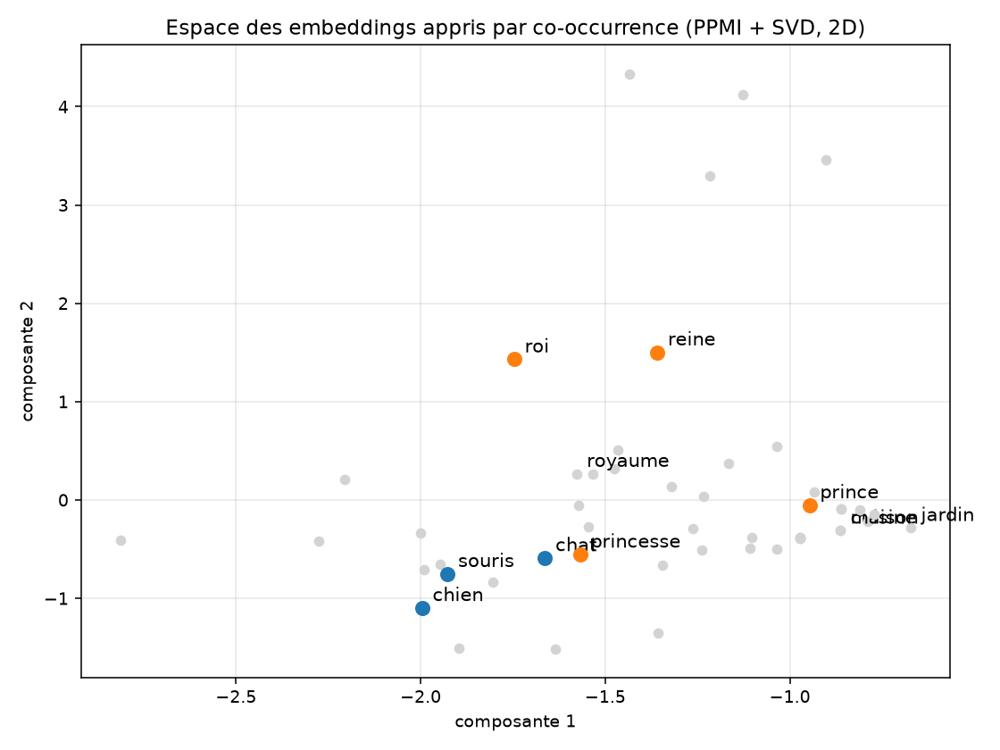
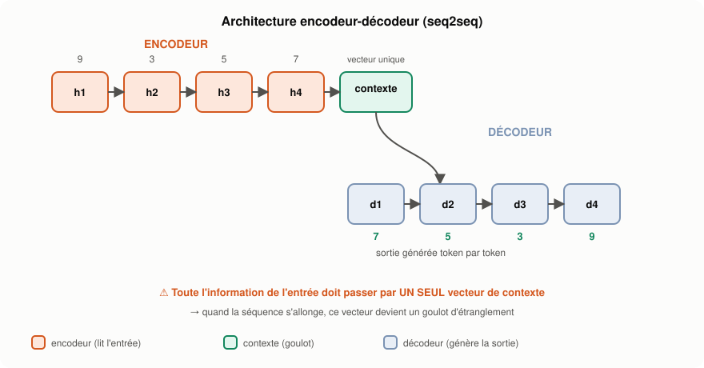
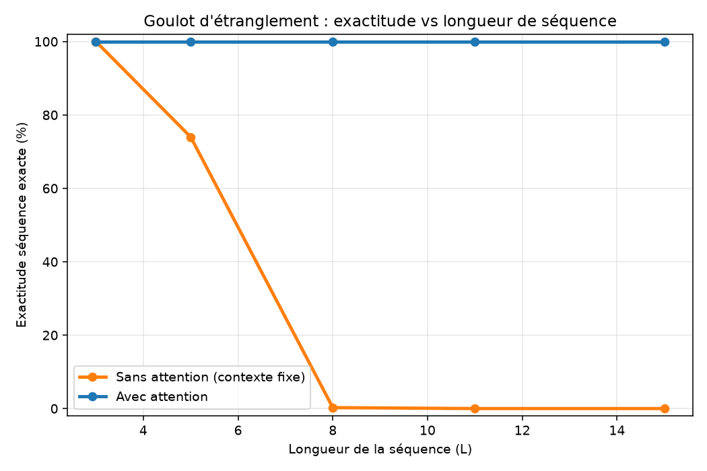
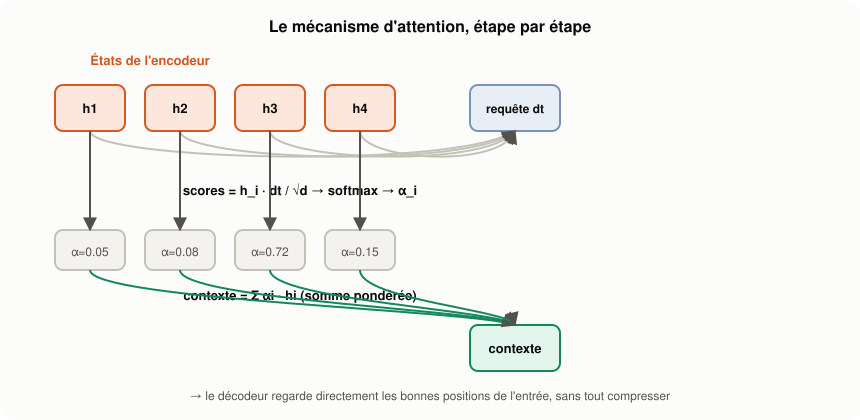
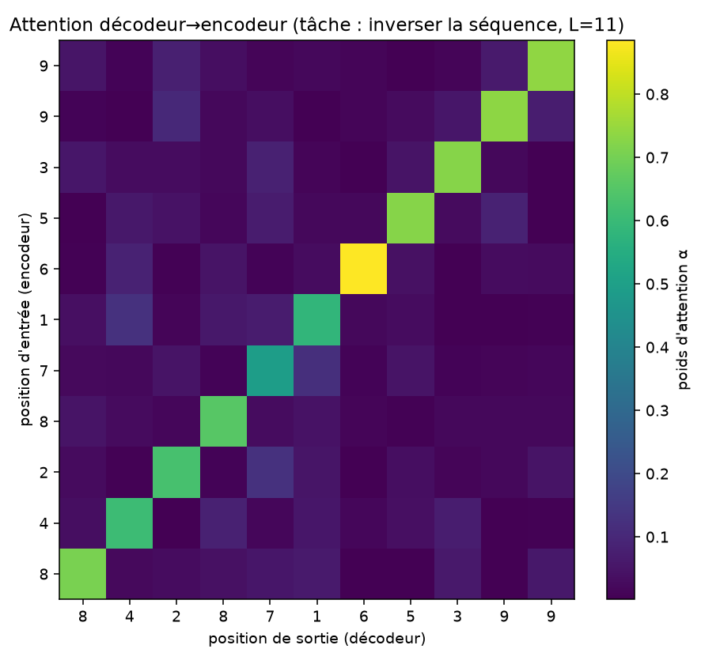
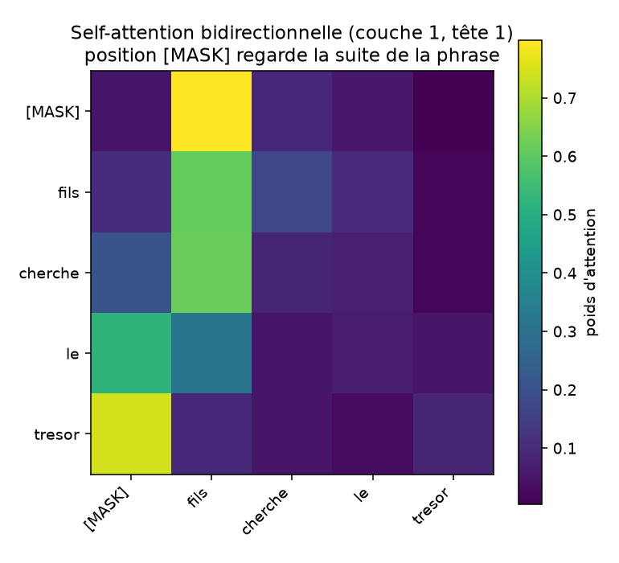
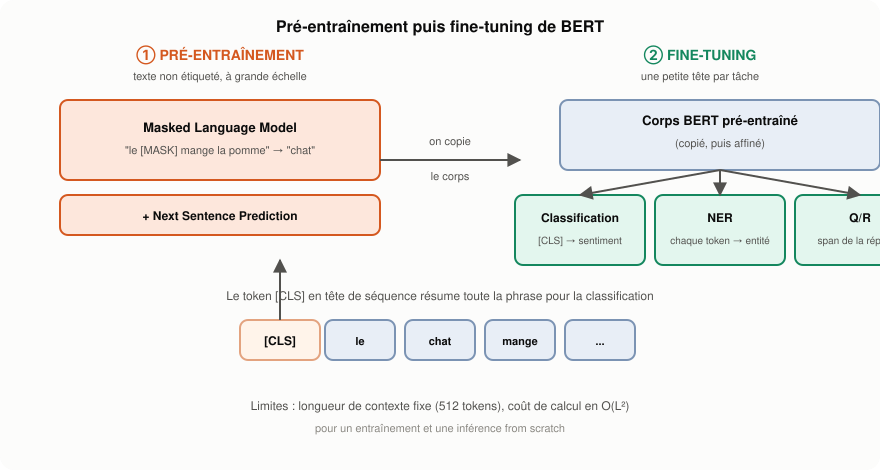
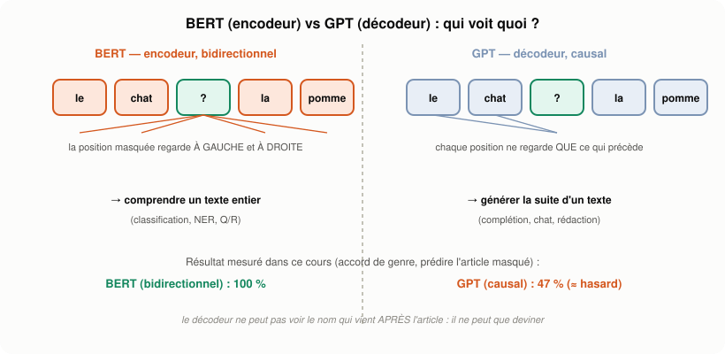

# 🔤 Encoder-Decoder and BERT — Cours Bootcamp Data Science

> **Module Data Science — Deep Learning** | Prérequis : cours "Forward & Backward Propagation" (`03-...md`), cours "Feature Extraction vs Fine-Tuning" (`05-...md`, pour le vocabulaire corps/tête et pré-entraînement/fine-tuning qui sera repris ici pour le texte)

---

## Table des matières

### Partie I — NLP
1. [Pourquoi le texte est difficile pour un réseau](#1-pourquoi-le-texte-est-difficile-pour-un-réseau)
2. [Les embeddings : donner un sens géométrique aux mots](#2-les-embeddings--donner-un-sens-géométrique-aux-mots)
3. [🧩 Rappel express : les réseaux récurrents et leur limite](#3--rappel-express--les-réseaux-récurrents-et-leur-limite)
4. [Le problème du vecteur de contexte unique](#4-le-problème-du-vecteur-de-contexte-unique)

### Partie II — Encoder-Decoder
5. [L'architecture seq2seq](#5-larchitecture-seq2seq)
6. [Tâche jouet : inverser une séquence de chiffres](#6-tâche-jouet--inverser-une-séquence-de-chiffres)
7. [Le goulot d'étranglement, mesuré](#7-le-goulot-détranglement-mesuré)
8. [Le mécanisme d'attention, pas à pas](#8-le-mécanisme-dattention-pas-à-pas)
9. [Avec attention : les résultats](#9-avec-attention--les-résultats)

### Partie III — BERT Architecture
10. [Self-attention : chaque mot regarde tous les autres](#10-self-attention--chaque-mot-regarde-tous-les-autres)
11. [Multi-têtes, position, et le bloc Transformer](#11-multi-têtes-position-et-le-bloc-transformer)
12. [BERT : pré-entraînement par Masked Language Model](#12-bert--pré-entraînement-par-masked-language-model)
13. [🧩 BERT en pratique : `[CLS]`, fine-tuning, cas d'usage](#13--bert-en-pratique--cls-fine-tuning-cas-dusage)
14. [🧩 BERT vs GPT : encodeur ou décodeur ?](#14--bert-vs-gpt--encodeur-ou-décodeur-)

### Partie IV — Synthèse
15. [Conclusion](#15-conclusion)
16. [✅ Point de contrôle — Encoder-Decoder and BERT](#16--point-de-contrôle--encoder-decoder-and-bert)

> 🧩 = notion ajoutée parce qu'elle est indispensable pour comprendre ou pratiquer.

> ⚙️ **Environnement** : tout le code de ce cours utilise uniquement **NumPy et scikit-learn** — pas de TensorFlow, PyTorch ni HuggingFace. On y reprend l'esprit des cours 03 et 05 : tout est codé « from scratch » pour **voir** le mécanisme, avec le même vocabulaire corps/tête/pré-entraînement/fine-tuning que le cours 05, appliqué cette fois au texte. Pour isoler clairement le phénomène de goulot d'étranglement et le mécanisme d'attention sans la lourdeur d'une implémentation RNN complète (déjà esquissée en figure), l'encodeur et le décodeur de la partie II sont simplifiés en couches **feedforward à poids partagés par position** — le goulot d'étranglement et l'attention qu'on y mesure sont rigoureusement les mêmes qu'avec un RNN. Le bloc Transformer de la partie III, lui, est implémenté intégralement (self-attention multi-têtes, position, Add & Norm, feed-forward). Tous les résultats affichés ont été **réellement exécutés** (chaque gradient a été vérifié par différences finies avant tout entraînement) et sont reproductibles grâce aux graines aléatoires fixées.

---

# PARTIE I — NLP

## 1. Pourquoi le texte est difficile pour un réseau

Un réseau de neurones ne travaille qu'avec des nombres. Une image est déjà une grille de pixels — un tableau de nombres. Un texte, lui, est une suite de **symboles discrets** (des mots) sans ordre numérique naturel : rien ne dit que "chat" doit être plus proche de "chien" que de "12", si ce n'est le sens qu'on y met.

Deux représentations historiques, déjà rencontrées en 03-data-science, permettent d'encoder du texte en vecteurs :

| Représentation | Principe | Limite |
|---|---|---|
| **Bag-of-words** | un vecteur de la taille du vocabulaire, 1 si le mot est présent | ignore l'ordre des mots, vecteurs énormes et creux |
| **TF-IDF** | pondère chaque mot par sa fréquence et sa rareté dans le corpus | toujours creux, toujours aucune notion de sens partagé entre mots proches |

Dans ces deux représentations, "chat" et "félin" sont aussi **éloignés** que "chat" et "banane" : chaque mot est une colonne isolée du vocabulaire, sans lien avec les autres. Pour qu'un réseau généralise (reconnaître qu'une phrase sur les "félins" ressemble à une phrase sur les "chats"), il faut une représentation où le **sens** se traduit par une **proximité géométrique**.

> 🔑 **La question de cette partie** : comment transformer un mot en vecteur de nombres réels, tel que des mots de sens proche aient des vecteurs proches ?

---

## 2. Les embeddings : donner un sens géométrique aux mots

Un **embedding** est un vecteur dense (quelques dizaines à quelques centaines de dimensions, contre des dizaines de milliers pour le bag-of-words) appris de telle sorte que la **position géométrique** d'un mot reflète les contextes dans lesquels il apparaît. L'intuition, posée par J.R. Firth en 1957 : *"you shall know a word by the company it keeps"* — un mot se définit par ses voisins.

Word2Vec (Mikolov et al., 2013) et GloVe (Pennington et al., 2014) ont popularisé cette idée en apprenant les embeddings directement sur des milliards de mots de texte. Nous en reproduisons le principe sur un mini-corpus pour voir le mécanisme :

1. compter combien de fois chaque paire de mots apparaît dans une **fenêtre** de quelques mots (co-occurrence) ;
2. repondérer ce comptage par la **PPMI** (Positive Pointwise Mutual Information), qui mesure si deux mots co-occurrent *plus souvent que si c'était le hasard* ;
3. réduire la matrice obtenue par **SVD** (comme pour la PCA) pour obtenir un vecteur dense par mot.

```python
import numpy as np

corpus = [
    "le roi gouverne le royaume avec sagesse",
    "la reine gouverne le royaume avec sagesse",
    "le roi porte une couronne dorée",
    "la reine porte une couronne dorée",
    "le prince est le fils du roi",
    "la princesse est la fille de la reine",
    "le chat chasse la souris dans la maison",
    "le chien chasse le chat dans le jardin",
    "le chat dort sur le canapé toute la journée",
    "le chien dort sur le tapis toute la journée",
    "la souris mange le fromage dans la cuisine",
    "le chat mange le poisson dans la cuisine",
    # ... 20 phrases au total
]
tokens = [s.split() for s in corpus]
vocab = sorted(set(w for s in tokens for w in s))
word2id = {w: i for i, w in enumerate(vocab)}
V = len(vocab)                                      # 50 mots

window = 2
cooc = np.zeros((V, V))
for s in tokens:
    ids = [word2id[w] for w in s]
    for i, wi in enumerate(ids):
        for j in range(max(0, i-window), min(len(ids), i+window+1)):
            if i != j:
                cooc[wi, ids[j]] += 1.0

Pij = cooc / cooc.sum()
Pi, Pj = Pij.sum(1, keepdims=True), Pij.sum(0, keepdims=True)
pmi = np.log(Pij / (Pi @ Pj) + 1e-12)
ppmi = np.maximum(pmi, 0.0)                         # on ne garde que le positif

U, S, Vt = np.linalg.svd(ppmi)
embeddings = U[:, :8] * S[:8]                        # 8 dimensions
```

Sur un corpus de 20 phrases (50 mots de vocabulaire), voici les similarités cosinus réellement obtenues entre quelques paires :

| Paire | Similarité cosinus |
|---|---|
| roi ↔ reine | **+0,552** |
| roi ↔ prince | +0,635 |
| reine ↔ princesse | +0,460 |
| chat ↔ chien | +0,633 |
| chat ↔ souris | +0,804 |
| roi ↔ souris | +0,184 |
| chien ↔ roi | +0,244 |



*Figure 1 — Projection 2D (SVD) des embeddings appris sur le mini-corpus. Les mots de la royauté (roi, reine, prince, princesse) se regroupent, de même que les animaux.*

> 💡 **Lecture honnête du résultat** : sur ce mini-corpus, `chat` et `souris` sont **plus proches** (0,804) que `chat` et `chien` (0,633) — parce que "chat" et "souris" partagent presque exactement les mêmes contextes (prédation, cuisine), alors que "chat" et "chien" rivalisent parfois (ils "chassent" l'un l'autre dans une phrase). C'est une leçon importante : un embedding par co-occurrence capture la **distribution statistique** du corpus, pas une notion humaine abstraite de catégorie sémantique. Avec un corpus de plusieurs milliards de mots (comme pour Word2Vec), ce bruit s'estompe et des régularités plus fines émergent (la fameuse analogie *roi - homme + femme ≈ reine*).

---

## 3. 🧩 Rappel express : les réseaux récurrents et leur limite

Une fois les mots transformés en embeddings, il faut un réseau qui **lit la phrase dans l'ordre** et construise une représentation de la séquence entière. Le réseau récurrent (RNN), déjà entraperçu dans son principe au cours 03, traite les mots un par un, en gardant un état caché qui résume ce qu'il a vu jusque-là :

$$h_t = \tanh(W_{xh}\, x_t + W_{hh}\, h_{t-1} + b)$$


*Figure 2 — Chaque état caché dépend du précédent. Le gradient qui sert à corriger les tout premiers mots doit remonter toute la chaîne lors de la backpropagation.*

C'est exactement la backpropagation du cours 03, mais **déroulée dans le temps** (on parle de *backpropagation through time*, BPTT) : le gradient qui doit corriger les poids utilisés au mot 1 doit traverser les mots 2, 3, 4… jusqu'au dernier. À chaque étape, il est multiplié par un facteur lié à la dérivée du tanh et aux poids récurrents. Si ce facteur est systématiquement **inférieur à 1**, le produit de 20 ou 50 facteurs successifs s'effondre vers zéro : c'est le problème du **gradient qui s'évanouit** (*vanishing gradient*), déjà vu en toute généralité au cours 03 — ici il est spécifiquement aggravé par la longueur de la séquence.

> ⚠️ **Conséquence pratique** : un RNN simple "oublie" progressivement les informations les plus anciennes de la séquence. Les variantes LSTM et GRU (hors scope ici) atténuent ce problème avec des portes, mais ne le suppriment pas : elles gardent toujours un **unique état caché** comme résumé de tout le passé.

---

## 4. Le problème du vecteur de contexte unique

Dans un RNN encodeur-décodeur classique, l'encodeur lit toute la phrase d'entrée et ne transmet au décodeur que **son tout dernier état caché** : un seul vecteur, de dimension fixe, censé résumer une phrase de 3 mots... ou de 50.

> 💡 **Analogie** : c'est comme demander à quelqu'un de lire un roman entier, puis de le résumer en une seule phrase de longueur fixe avant de répondre à n'importe quelle question dessus — nom des personnages, événements du chapitre 3, dernière phrase du livre. Plus le roman est long, plus ce résumé unique perd de détails précis.

Peut-on éviter de tout compresser dans un seul vecteur, et laisser le décodeur **aller rechercher** l'information pertinente directement dans la séquence d'entrée, à chaque mot qu'il génère ? C'est exactement l'idée de l'**attention**, introduite par Bahdanau, Cho et Bengio en 2014. La partie II la construit et la mesure, chiffres à l'appui.

---

# PARTIE II — ENCODER-DECODER

## 5. L'architecture seq2seq

Un modèle **encodeur-décodeur** (*sequence-to-sequence*, seq2seq) transforme une séquence d'entrée en une séquence de sortie, potentiellement de longueur différente — traduction, résumé, correction de texte, conversion de format...



*Figure 3 — L'encodeur lit l'entrée et produit un vecteur de contexte ; le décodeur part de ce vecteur et génère les tokens de sortie un par un.*

| Composant | Rôle |
|---|---|
| **Encodeur** | lit toute la séquence d'entrée, produit un état caché par position |
| **Contexte** | résumé transmis à l'encodeur (un seul vecteur, ou — avec attention — tous les états) |
| **Décodeur** | génère la séquence de sortie un token à la fois, à partir du contexte |

> 🔑 **En une phrase** : *le vocabulaire est le même qu'au cours 05 — l'encodeur est un "corps" qui construit une représentation, le décodeur est la "tête" qui produit une sortie — sauf qu'ici la tête elle-même est un réseau qui génère une séquence, pas une simple classe.*

---

## 6. Tâche jouet : inverser une séquence de chiffres

Pour mesurer concrètement le goulot d'étranglement puis l'apport de l'attention, on choisit une tâche simple mais révélatrice : **inverser une séquence de chiffres** (ex. `9 3 5 7` → `7 5 3 9`). Cette tâche exige de retrouver la **position exacte** de chaque symbole — un test sévère pour un résumé compressé.

Pour isoler le phénomène sans la complexité d'un RNN complet (son principe est illustré figure 2), l'encodeur et le décodeur sont des couches **feedforward à poids partagés entre positions**, avec un **encodage de position** ajouté à chaque embedding (comme on le fera en partie III pour les Transformers) :

```python
VOCAB, D_EMB, D_HID, D_CTX = 10, 16, 32, 24   # 10 chiffres, dimensions des couches

def forward_sans_attention(p, X):
    B, L = X.shape
    Emb = p['E'][X] + p['P'][np.arange(L)][None, :, :]                    # embeddings + position
    Henc = np.tanh(np.einsum('hd,bld->blh', p['Wenc'], Emb) + p['benc'])  # état par position

    ctx = np.tanh(np.einsum('cd,bld->bc', p['Wctx'], Henc) / L + p['bctx'])  # ⚠️ UN SEUL vecteur,
    Q = np.tanh(np.einsum('hd,ld->lh', p['Wq'], p['Pq'][:L]) + p['bq'])      #    par moyenne sur L positions
    combined = np.concatenate([np.broadcast_to(ctx[:, None, :], (B, L, D_CTX)),
                                np.broadcast_to(Q[None, :, :], (B, L, D_HID))], axis=-1)
    Dec = np.tanh(np.einsum('hd,blc->blh', p['Wdec'], combined) + p['bdec'])
    logits = np.einsum('vh,blh->blv', p['Wout'], Dec) + p['bout']
    return logits
```

Le modèle est entraîné par descente de gradient (Adam, rétropropagation classique — **tous les gradients ont été vérifiés par différences finies** avant tout entraînement, écart < 10⁻¹⁰) sur des séquences aléatoires générées à la volée, pour plusieurs longueurs `L`.

---

## 7. Le goulot d'étranglement, mesuré

On entraîne ce modèle (1 500 itérations, lot de 64 séquences) pour chaque longueur `L`, et on mesure l'exactitude **séquence exacte** (toute la séquence inversée correctement) sur 2 000 séquences de test fraîches :

| Longueur L | Exactitude séquence exacte | Exactitude par chiffre |
|---|---|---|
| 3 | **100,0 %** | 100,0 % |
| 5 | **74,0 %** | 94,3 % |
| 8 | **0,2 %** | 58,5 % |
| 11 | **0,0 %** | 37,4 % |
| 15 | **0,0 %** | 28,8 % |



*Figure 4 — Sans attention, l'exactitude s'effondre dès que la séquence dépasse quelques symboles : le vecteur de contexte unique ne peut pas tout retenir. Avec attention (courbe bleue, section 9), elle reste à 100 % quelle que soit la longueur.*

> 🔑 **En une phrase** : *le modèle apprend parfaitement à inverser 3 chiffres, mais devient presque incapable d'inverser 8 chiffres ou plus — pas parce que la tâche est conceptuellement plus dure, mais parce que le vecteur de contexte (24 nombres) ne suffit plus à coder la position exacte de chaque chiffre parmi un nombre croissant de possibilités.*

---

## 8. Le mécanisme d'attention, pas à pas

Plutôt que de résumer l'entrée en un seul vecteur, l'attention laisse le décodeur consulter **tous** les états de l'encodeur à chaque étape, et calculer une moyenne pondérée de ceux qui sont pertinents *pour la position en cours de génération*.



*Figure 5 — Pour chaque position de sortie, une requête compare les états de l'encodeur (score de similarité), le softmax transforme ces scores en poids qui somment à 1, puis la somme pondérée donne le contexte de cette étape.*

Trois étapes, pour une position de sortie donnée (requête $q$) et les états de l'encodeur $h_1, \dots, h_L$ :

1. **Scores** : $\text{score}_i = \dfrac{q \cdot h_i}{\sqrt{d}}$ — à quel point $h_i$ est-il pertinent pour cette sortie ?
2. **Softmax** : $\alpha_i = \text{softmax}(\text{score})_i$ — les scores deviennent des poids positifs qui somment à 1.
3. **Contexte pondéré** : $\text{contexte} = \sum_i \alpha_i\, h_i$ — au lieu d'un contexte fixe, **un contexte différent à chaque position de sortie**.

```python
def attention(Q, Henc):                       # Q: (L_out, D) requêtes, Henc: (B, L_in, D) états
    scores = np.einsum('blh,oh->blo', Henc, Q) / np.sqrt(Henc.shape[-1])   # (B, L_in, L_out)
    alpha = softmax(scores, axis=1)                                         # softmax sur L_in
    context = np.einsum('blo,blh->boh', alpha, Henc)                        # (B, L_out, D)
    return context, alpha
```

La différence capitale avec la section 6 : le contexte n'est plus moyenné une fois pour toutes sur les `L` positions (perdant l'info de position), mais recalculé — avec des poids différents — **pour chaque position de sortie**.

---

## 9. Avec attention : les résultats

On entraîne le même modèle, attention en plus, avec les mêmes hyperparamètres :

| Longueur L | Sans attention (exact) | **Avec attention (exact)** |
|---|---|---|
| 3 | 100,0 % | **100,0 %** |
| 5 | 74,0 % | **100,0 %** |
| 8 | 0,2 % | **100,0 %** |
| 11 | 0,0 % | **100,0 %** |
| 15 | 0,0 % | **100,0 %** |

Quelle que soit la longueur testée (jusqu'à 15 chiffres), le modèle avec attention reste à **100 % d'exactitude exacte** — la figure 4 ci-dessus trace les deux courbes côte à côte.



*Figure 6 — Exemple réel, L=11, entrée `9 9 3 5 6 1 7 8 2 4 8`. Pour chaque position de sortie (axe horizontal), le poids d'attention (axe vertical = position d'entrée) se concentre presque entièrement sur la position symétrique — exactement ce qu'il faut pour inverser la séquence. Poids d'attention maximal moyen : 0,68.*

Le modèle a appris, **sans qu'on le lui dise explicitement**, que pour générer la sortie en position `o`, il faut regarder l'entrée en position `L-1-o` : la correspondance argmax mesurée est exactement `[10, 9, 8, 7, 6, 5, 4, 3, 2, 1, 0]` pour une entrée de longueur 11 — parfaitement alignée avec la tâche d'inversion.

> ⚠️ **Attention** : ce gain n'est pas gratuit. Le mécanisme d'attention calcule un score entre **chaque position de sortie et chaque position d'entrée** : son coût croît en $O(L_{in} \times L_{out})$, contre $O(L)$ pour un simple résumé. C'est un compromis mémoire/calcul contre exactitude — un compromis que la partie III pousse jusqu'au bout.

---

# PARTIE III — BERT ARCHITECTURE

## 10. Self-attention : chaque mot regarde tous les autres

L'attention de la partie II reliait un décodeur à un encodeur (*cross-attention*). L'idée clé des Transformers (Vaswani et al., *Attention Is All You Need*, 2017) est d'appliquer ce **même mécanisme à l'intérieur d'une seule séquence** : chaque mot calcule un score avec **tous les mots de la même phrase**, y compris lui-même. C'est la **self-attention**.

Chaque position produit trois vecteurs à partir de son embedding $x$ :

| Vecteur | Rôle | Formule |
|---|---|---|
| **Query** (requête) | "qu'est-ce que je cherche ?" | $Q = X W_Q$ |
| **Key** (clé) | "qu'est-ce que je propose ?" | $K = X W_K$ |
| **Value** (valeur) | "qu'est-ce que je transmets si on me choisit ?" | $V = X W_V$ |

```python
def self_attention(X, Wq, Wk, Wv):                 # X: (L, d)
    Q, K, V = X @ Wq, X @ Wk, X @ Wv
    scores = Q @ K.T / np.sqrt(Q.shape[-1])         # (L, L) — tout le monde regarde tout le monde
    alpha = softmax(scores, axis=-1)
    return alpha @ V, alpha
```

> 💡 **Analogie** : dans une réunion, chaque participant (une position) pose une question (*query*), chacun des autres participants propose une étiquette qui résume ce qu'il peut apporter (*key*), et si l'étiquette correspond à la question, on écoute vraiment ce que cette personne a à dire (*value*) — en pondérant par la pertinence (le score). Contrairement à l'attention de la partie II, ici **tout le monde** joue aussi bien le rôle de celui qui interroge que de celui qu'on interroge.

Ce calcul ne contient **aucune récurrence** : toutes les positions sont traitées en parallèle (contrairement au RNN de la section 3, qui doit attendre $h_{t-1}$ pour calculer $h_t$). C'est l'une des raisons du succès des Transformers : l'entraînement se parallélise massivement sur GPU.

---

## 11. Multi-têtes, position, et le bloc Transformer

**Multi-têtes.** Une seule self-attention ne capture qu'un seul type de relation (ex. accord grammatical). On calcule donc plusieurs self-attentions en parallèle — plusieurs **têtes** — chacune avec ses propres $W_Q, W_K, W_V$ de dimension réduite, puis on concatène leurs sorties :

```python
def multi_head_attention(X, heads):           # heads: liste de (Wq, Wk, Wv) par tête
    outs = [self_attention(X, Wq, Wk, Wv)[0] for Wq, Wk, Wv in heads]
    return np.concatenate(outs, axis=-1) @ Wo  # projection finale
```

**Encodage positionnel.** La self-attention, seule, ne voit aucun ordre : échanger deux mots de la phrase ne change rien à ses scores. On ajoute donc à chaque embedding un vecteur de position **fixe**, construit avec des sinus et cosinus de fréquences différentes (Vaswani et al., 2017) :

```python
def encodage_positionnel(L, d):
    pos = np.arange(L)[:, None]
    i = np.arange(d)[None, :]
    angle = pos / np.power(10000, (2 * (i // 2)) / d)
    pe = np.zeros((L, d))
    pe[:, 0::2] = np.sin(angle[:, 0::2])
    pe[:, 1::2] = np.cos(angle[:, 1::2])
    return pe
```

**Le bloc Transformer complet** empile multi-head self-attention, une connexion résiduelle + normalisation (*Add & Norm*), un petit réseau feed-forward appliqué indépendamment à chaque position, puis à nouveau Add & Norm :


*Figure 7 — L'empilement utilisé par BERT. Chaque position regarde toutes les autres (gauche ET droite) : c'est précisément ce qui distingue BERT d'un décodeur comme GPT (section 14).*

Les connexions résiduelles (`X + Attention(X)`, comme au cours 04 pour les CNN profonds) évitent que le gradient s'évanouisse en empilant des blocs ; la normalisation (*LayerNorm*, qui standardise chaque position indépendamment plutôt que chaque lot comme la BatchNorm) stabilise l'entraînement. Nous avons implémenté — et vérifié par différences finies — la rétropropagation complète à travers self-attention multi-têtes, Add & Norm et feed-forward, sur 2 couches empilées, avant tout entraînement réel.

---

## 12. BERT : pré-entraînement par Masked Language Model

BERT (*Bidirectional Encoder Representations from Transformers*, Devlin et al., 2018) empile ce bloc Transformer encodeur et le pré-entraîne sur un objectif astucieux : le **Masked Language Model (MLM)**. On masque aléatoirement des mots de la phrase, et le modèle doit les retrouver **en utilisant le contexte des deux côtés**.

Pour le mesurer concrètement, on génère 576 phrases de 5 tokens à partir de gabarits (`<article> <sujet> <verbe> <article> <objet>`, ex. *"le chat mange la pomme"*), séparées en 176 phrases d'entraînement et 400 phrases de test (combinaisons sujet/verbe/objet **jamais vues ensemble** à l'entraînement — un test de généralisation strict). On masque un mot, et on entraîne le modèle à le retrouver (perte d'entropie croisée uniquement sur la position masquée) :

```python
MASK_ID = V   # token spécial [MASK]
logits, cache = model.forward(tokens_masques, position_masquee)   # (B, vocab)
grads = model.backward(tokens_masques, position_masquee, logits, cache, cible)
```

| Modèle | Masquage sur toutes les positions | Masquage de l'article seul (accord de genre) |
|---|---|---|
| **Bidirectionnel (encodeur, style BERT)** | **49,8 %** | **100,0 %** |
| Causal (décodeur, style GPT — section 14) | 29,1 % | 47,4 % |

L'expérience la plus parlante : masquer uniquement l'**article** (`le`/`la`) juste avant un nom, et demander au modèle de deviner son genre. Exemple réel tiré du jeu de test :

```
Phrase masquée : [MASK] fils cherche le tresor
Vérité          : le
Prédiction (modèle bidirectionnel) : le   ✅
```



*Figure 8 — Le poids d'attention mesuré depuis `[MASK]` se porte à 79,8 % sur le mot "fils", juste après : le modèle a appris à regarder le nom qui **suit** l'article pour déterminer son genre, une information invisible à un modèle qui ne lirait que de gauche à droite (section 14).*

Le modèle bidirectionnel atteint **100 %** sur cette tâche d'accord de genre : il lui suffit de regarder à droite. Pourquoi le modèle causal plafonne-t-il à 47,4 % (proche du hasard, puisque ~56 % des sujets/objets du corpus utilisent "le") ? La section 14 répond précisément à cette question.

> 🧩 **Tokenisation et Next Sentence Prediction**. En pratique, BERT ne découpe pas le texte en mots entiers mais en **sous-mots** (WordPiece) : un mot rare comme "tokenisation" peut être découpé en `token` + `##isation`, ce qui limite la taille du vocabulaire tout en gérant les mots inconnus. BERT est aussi entraîné sur un second objectif, la **Next Sentence Prediction** (deux phrases se suivent-elles vraiment, ou sont-elles tirées au hasard ?), pour apprendre des relations entre phrases — un objectif que des travaux ultérieurs (RoBERTa, 2019) ont montré peu utile et souvent retiré.

---

## 13. 🧩 BERT en pratique : `[CLS]`, fine-tuning, cas d'usage

Comme au cours 05 (feature extraction / fine-tuning), on **sépare** le pré-entraînement, coûteux et générique, du fine-tuning, rapide et spécifique à une tâche :



*Figure 9 — Le corps BERT pré-entraîné est copié, puis une petite tête spécifique est ajoutée et affinée pour chaque tâche : classification, reconnaissance d'entités nommées, question-réponse...*

Un token spécial, `[CLS]`, est ajouté au début de chaque séquence. N'ayant pas de sens propre, il devient — grâce à la self-attention — un résumé de toute la phrase, exploitable pour la classification :

| Tâche | Ce qu'on branche sur BERT | Exemple |
|---|---|---|
| **Classification de texte** | une couche dense sur le vecteur `[CLS]` | sentiment d'un avis client |
| **NER** (reconnaissance d'entités) | une couche dense sur **chaque** token | repérer les noms de personnes, lieux |
| **Question-réponse** | prédire les positions de début/fin de la réponse dans le texte | SQuAD |
| **Similarité de phrases** | comparer deux vecteurs `[CLS]` | recherche sémantique |

> ⚠️ **Limites de BERT** : une longueur de contexte fixe (512 tokens dans la version originale — un document long doit être découpé) ; un coût de calcul en $O(L^2)$ à cause de la self-attention (doubler la longueur de la phrase quadruple le calcul) ; et, comme tout modèle pré-entraîné (cours 05, section 16), il hérite des biais du texte sur lequel il a appris.

---

## 14. 🧩 BERT vs GPT : encodeur ou décodeur ?

Le bloc Transformer de la section 11 peut s'utiliser de deux façons :



*Figure 10 — La différence tient en une seule ligne de code : un masque triangulaire sur les scores d'attention, qui interdit de regarder les positions futures.*

| | **BERT** (encodeur) | **GPT** (décodeur) |
|---|---|---|
| Self-attention | **bidirectionnelle** : chaque position voit toute la phrase | **causale** : chaque position ne voit que ce qui précède |
| Pré-entraînement | Masked Language Model (deviner un mot caché n'importe où) | prédiction du mot **suivant** (gauche → droite) |
| Bon pour | **comprendre** un texte entier (classification, NER, Q/R) | **générer** la suite d'un texte (chat, rédaction, code) |
| Résultat mesuré (accord de genre, section 12) | **100 %** | 47,4 % (≈ hasard) |

Techniquement, la seule différence est un **masque causal** sur les scores d'attention — une ligne de code qui interdit à la position $i$ de regarder les positions $j > i$ :

```python
causal_mask = np.triu(np.ones((L, L)), k=1).astype(bool)
scores = np.where(causal_mask, -1e9, scores)     # -inf avant softmax -> poids nul après
```

C'est exactement ce que confirme l'expérience de la section 12 : en position 0 (l'article), un modèle causal n'a **aucun contexte précédent** — ni le mot qui suit (le nom), ni rien avant. Il ne peut que deviner la fréquence du corpus (≈ 56 % de "le"), d'où son 47,4 %. Le modèle bidirectionnel, lui, regarde le nom juste après (79,8 % du poids d'attention mesuré figure 8) et répond juste à tous les coups.

> 🔑 **En une phrase** : *BERT est un encodeur (bidirectionnel) optimisé pour comprendre ; GPT est un décodeur (causal) optimisé pour générer — et les grands modèles de langage modernes combinent souvent les deux idées (certains encodeur-décodeur, comme T5, d'autres décodeur seul mais à très grande échelle, comme la famille GPT).*

---

# PARTIE IV — SYNTHÈSE

## 15. Conclusion

### 🎓 Ce qu'il faut absolument retenir

1. **Les embeddings transforment les mots en vecteurs denses** où la proximité géométrique reflète les contextes partagés — mesuré ici par co-occurrence + PPMI + SVD, la même logique profonde (en plus riche) que Word2Vec et GloVe.

2. **Les RNN traitent le texte dans l'ordre mais souffrent du gradient qui s'évanouit** : l'information des premiers mots s'estompe avant d'atteindre les derniers lors de la rétropropagation à travers le temps.

3. **Un encodeur-décodeur classique compresse toute la séquence d'entrée en un seul vecteur de contexte** — un goulot d'étranglement mesuré ici très concrètement : exactitude exacte de 100 % à L=3, effondrée à 0 % dès L=8.

4. **L'attention permet au décodeur de consulter tous les états de l'encodeur**, avec un poids différent à chaque étape de génération : exactitude à 100 % quelle que soit la longueur testée (jusqu'à 15), et des poids d'attention parfaitement interprétables (une diagonale inversée pour une tâche d'inversion).

5. **La self-attention applique ce même mécanisme à l'intérieur d'une seule séquence** : chaque position calcule un score avec toutes les autres (Q, K, V), sans aucune récurrence — d'où la parallélisation massive des Transformers.

6. **Le bloc Transformer combine self-attention multi-têtes, encodage positionnel, connexions résiduelles et normalisation**, empilé N fois.

7. **BERT pré-entraîne ce bloc par Masked Language Model**, en tirant parti de sa self-attention **bidirectionnelle** : mesuré ici à 100 % sur une tâche d'accord de genre nécessitant de regarder à droite, contre 47,4 % pour un modèle causal privé de ce contexte futur.

8. **Le fine-tuning de BERT suit exactement le schéma du cours 05** : corps pré-entraîné copié, petite tête spécifique par tâche (classification via `[CLS]`, NER par token, question-réponse).

9. **BERT (encodeur, bidirectionnel) et GPT (décodeur, causal) ne diffèrent que par un masque** sur les scores d'attention — mais ce détail change complètement l'usage : comprendre pour l'un, générer pour l'autre.

### 🧭 Le mémo en une image

```
┌──────────────────────────────────────────────────────────────────────────┐
│  TEXTE BRUT        ──►  EMBEDDINGS        proximité géométrique = sens    │
│  SÉQUENCE LONGUE   ──►  ATTENTION         pas de compression avec perte   │
│  "regarder partout"──►  SELF-ATTENTION    Q·K → softmax → Σ αV, parallèle │
│  COMPRENDRE        ──►  BERT (encodeur)   bidirectionnel, MLM             │
│  GÉNÉRER           ──►  GPT (décodeur)    causal, mot suivant             │
│                                                                            │
│  Le goulot d'étranglement se mesure : 100 % → 0 % sans attention (L↑)     │
│  L'accès au futur se mesure : 100 % (BERT) vs 47 % (GPT) sur le genre     │
└──────────────────────────────────────────────────────────────────────────┘
```

> 🔑 **En une phrase** : *l'attention remplace un résumé unique par un accès direct et pondéré à toute l'information disponible — et la self-attention bidirectionnelle de BERT étend cet accès à toute la phrase, dans les deux sens, ce qui en fait un excellent "lecteur" mais pas un générateur.*

---

## 16. ✅ Point de contrôle — Encoder-Decoder and BERT

### 🧠 Questions de compréhension

<details>
<summary><b>1. Pourquoi le bag-of-words et le TF-IDF ne suffisent-ils pas à capturer le sens d'un mot ?</b></summary>

Parce que chaque mot y est une colonne isolée du vocabulaire : deux mots de sens proche ("chat" et "félin") sont, dans cette représentation, aussi éloignés que deux mots sans rapport. Il n'y a aucune notion de proximité sémantique codée dans les vecteurs eux-mêmes.
</details>

<details>
<summary><b>2. Comment construit-on un embedding par co-occurrence, en trois étapes ?</b></summary>

(1) Compter combien de fois chaque paire de mots apparaît dans une fenêtre de contexte ; (2) repondérer ce comptage par la PPMI, qui mesure si la co-occurrence dépasse le hasard ; (3) réduire la matrice obtenue par SVD pour obtenir un vecteur dense par mot.
</details>

<details>
<summary><b>3. Dans l'expérience du cours, pourquoi "chat" et "souris" sont-ils plus proches que "chat" et "chien" ?</b></summary>

Parce que la similarité par co-occurrence reflète les contextes statistiques du corpus, pas une catégorie sémantique abstraite : "chat" et "souris" partagent presque exactement les mêmes contextes (prédation, cuisine) dans ce mini-corpus, alors que "chat" et "chien" s'y opposent parfois (ils se "chassent").
</details>

<details>
<summary><b>4. Qu'est-ce que le vanishing gradient dans un RNN, et pourquoi s'aggrave-t-il avec la longueur de la séquence ?</b></summary>

Lors de la rétropropagation à travers le temps, le gradient destiné à corriger les poids utilisés aux premiers pas de temps doit traverser tous les pas de temps suivants. À chaque pas, il est multiplié par un facteur souvent inférieur à 1 ; plus la séquence est longue, plus de multiplications s'enchaînent, et plus le gradient s'approche de zéro avant d'atteindre le début.
</details>

<details>
<summary><b>5. Qu'est-ce que le goulot d'étranglement du vecteur de contexte, et comment ce cours l'a-t-il mesuré ?</b></summary>

Toute l'information de la séquence d'entrée doit être compressée dans un unique vecteur de dimension fixe avant que le décodeur puisse l'utiliser. Mesuré sur la tâche d'inversion de chiffres : exactitude de 100 % à L=3, 74 % à L=5, puis quasiment 0 % dès L=8 — la capacité du vecteur ne suit pas la longueur de la séquence.
</details>

<details>
<summary><b>6. Décrivez les trois étapes du mécanisme d'attention.</b></summary>

(1) Calculer un score de pertinence entre la requête (position de sortie courante) et chaque état de l'encodeur ; (2) transformer ces scores en poids positifs qui somment à 1 via un softmax ; (3) calculer le contexte comme la somme des états de l'encodeur pondérés par ces poids.
</details>

<details>
<summary><b>7. Pourquoi l'attention élimine-t-elle le goulot d'étranglement, et à quel prix ?</b></summary>

Parce qu'elle ne résume plus l'entrée en un seul vecteur fixe : le décodeur accède directement à tous les états de l'encodeur, avec des poids recalculés à chaque étape. Le prix est un coût de calcul qui croît en O(longueur d'entrée × longueur de sortie), au lieu de O(longueur) pour un simple résumé.
</details>

<details>
<summary><b>8. Qu'est-ce que la self-attention, et en quoi diffère-t-elle de l'attention encodeur-décodeur de la partie II ?</b></summary>

C'est le même mécanisme (scores, softmax, somme pondérée) appliqué à l'intérieur d'une seule séquence : chaque position calcule un score avec toutes les positions de la même phrase (y compris elle-même), via ses propres Query, Key et Value — alors que l'attention de la partie II reliait les positions d'une séquence de sortie à celles d'une séquence d'entrée différente.
</details>

<details>
<summary><b>9. À quoi servent respectivement Query, Key et Value dans la self-attention ?</b></summary>

La Query représente "ce que cette position cherche", la Key représente "ce que chaque autre position propose" (comparée à la Query pour calculer le score), et la Value représente "ce que cette autre position transmet réellement" une fois pondérée par le score d'attention.
</details>

<details>
<summary><b>10. Pourquoi ajoute-t-on un encodage positionnel aux embeddings avant la self-attention ?</b></summary>

Parce que la self-attention, seule, est invariante à l'ordre des positions : échanger deux mots de la phrase ne changerait rien à ses scores. L'encodage positionnel (sinus/cosinus de fréquences différentes) injecte l'information de position, qui serait sinon perdue.
</details>

<details>
<summary><b>11. Qu'est-ce que l'objectif de Masked Language Model, et pourquoi BERT peut-il s'en servir alors qu'un RNN classique aurait du mal ?</b></summary>

On masque un ou plusieurs mots d'une phrase et on entraîne le modèle à les retrouver à partir du contexte. Grâce à sa self-attention bidirectionnelle, BERT peut utiliser le contexte à gauche ET à droite du mot masqué dans un seul passage — un RNN classique, qui lit dans un seul sens, ne verrait naturellement que le contexte d'un seul côté.
</details>

<details>
<summary><b>12. Dans l'expérience d'accord de genre, pourquoi le modèle causal plafonne-t-il à 47,4 % alors que le modèle bidirectionnel atteint 100 % ?</b></summary>

L'article à deviner est en tout début de séquence : un modèle causal n'a, à cette position, aucun contexte précédent utilisable et ne peut que reproduire la fréquence du corpus (≈ 56 % de "le"). Le modèle bidirectionnel, lui, regarde directement le nom qui suit l'article (mesuré à 79,8 % du poids d'attention) pour déterminer son genre.
</details>

<details>
<summary><b>13. À quoi sert le token `[CLS]`, et comment BERT est-il fine-tuné pour une nouvelle tâche ?</b></summary>

`[CLS]` est un token ajouté en tête de séquence qui, grâce à la self-attention, devient un résumé de toute la phrase — exploité pour la classification. Le fine-tuning suit le schéma du cours 05 : on copie le corps BERT pré-entraîné et on ajoute/entraîne une petite tête spécifique (classification sur `[CLS]`, étiquetage par token pour le NER, prédiction de positions pour la question-réponse).
</details>

<details>
<summary><b>14. Quelle est la seule différence technique entre un bloc Transformer encodeur (BERT) et décodeur (GPT) ?</b></summary>

Un masque causal appliqué aux scores d'attention avant le softmax, qui met à `-∞` (donc à un poids nul après softmax) les scores vers les positions futures. BERT n'a pas ce masque (bidirectionnel), GPT l'a (causal).
</details>

### 🛠️ Exercices pratiques

1. **Changer de tâche jouet** : remplacez la cible `Y = X[:, ::-1]` (inversion) par une tâche de tri (`Y = np.sort(X, axis=1)`) dans `seq2seq.py`. Le goulot d'étranglement apparaît-il à la même longueur ? Pourquoi le tri pourrait-il être plus ou moins sensible au goulot que l'inversion ?
2. **Capacité du contexte** : dans le modèle sans attention, faites varier `D_CTX` (8, 24, 64) à `L=8` fixé. À partir de quelle taille le goulot d'étranglement disparaît-il presque ? Reliez votre observation à l'idée de "capacité d'information" d'un vecteur de dimension fixe.
3. **Une seule tête ou plusieurs ?** Dans le mini-Transformer, entraînez un modèle à `n_heads=1` et un à `n_heads=4` (même `d_model`) sur la tâche de masquage de l'article. Les deux atteignent-ils 100 % ? Inspectez les poids d'attention de chaque tête : capturent-elles la même relation ?
4. **Masque causal partiel** : modifiez `causal_mask` pour n'autoriser qu'une fenêtre des `k` positions précédentes (ni tout le passé, ni le futur). Mesurez l'accuracy sur la tâche "toutes positions" pour `k=1, 2, 4`. Que cela vous apprend-il sur le compromis entre contexte local et contexte global ?

---

*📘 Module Data Science — Encoder-Decoder and BERT | Bootcamp Data Science*
