# 🧬 Advanced Architectures — Autoencoders, VAE et Diffusion Models — Cours Bootcamp Data Science

> **Module Data Science — Deep Learning** | Prérequis : cours "Forward & Backward Propagation" (`03-...md`), cours "Encoder-Decoder and BERT" (`06-...md`, pour le vocabulaire **encodeur** / **décodeur**)

---

## Table des matières

### Partie I — Autoencoders
1. [Du couple encodeur/décodeur à la reconstruction](#1-du-couple-encodeurdécodeur-à-la-reconstruction)
2. [Architecture : un goulot d'étranglement latent](#2-architecture--un-goulot-détranglement-latent)
3. [🧩 Implémentation NumPy et entraînement sur des chiffres manuscrits](#3--implémentation-numpy-et-entraînement-sur-des-chiffres-manuscrits)
4. [🧩 Trois usages pratiques](#4--trois-usages-pratiques)
5. [🧩 La limite : un espace latent non structuré](#5--la-limite--un-espace-latent-non-structuré)

### Partie II — Variational Autoencoder (VAE)
6. [L'idée probabiliste : encoder une distribution, pas un point](#6-lidée-probabiliste--encoder-une-distribution-pas-un-point)
7. [🧩 Le reparameterization trick](#7--le-reparameterization-trick)
8. [La loss du VAE : reconstruction + divergence KL](#8-la-loss-du-vae--reconstruction--divergence-kl)
9. [🧩 Expérience : un espace latent structuré, et la génération](#9--expérience--un-espace-latent-structuré-et-la-génération)
10. [🧩 β-VAE : le curseur reconstruction / régularité](#10--β-vae--le-curseur-reconstruction--régularité)
11. [Autoencodeur classique vs VAE : la comparaison](#11-autoencodeur-classique-vs-vae--la-comparaison)

### Partie III — Diffusion Models
12. [L'idée : détruire par le bruit, puis apprendre à inverser](#12-lidée--détruire-par-le-bruit-puis-apprendre-à-inverser)
13. [Le planning de bruit et le processus direct](#13-le-planning-de-bruit-et-le-processus-direct)
14. [Le processus inverse : apprendre à débruiter](#14-le-processus-inverse--apprendre-à-débruiter)
15. [🧩 Implémentation NumPy et expérience sur un jeu de données 2D](#15--implémentation-numpy-et-expérience-sur-un-jeu-de-données-2d)
16. [🧩 Panorama des modèles génératifs](#16--panorama-des-modèles-génératifs)
17. [🧩 La diffusion en pratique aujourd'hui](#17--la-diffusion-en-pratique-aujourdhui)

### Partie IV — Synthèse
18. [Conclusion](#18-conclusion)
19. [✅ Point de contrôle — Autoencoders, VAE et Diffusion](#19--point-de-contrôle--autoencoders-vae-et-diffusion)

> 🧩 = notion ajoutée parce qu'elle est indispensable pour comprendre ou pratiquer.

> ⚙️ **Environnement** : comme au cours 05, tout le code de ce cours utilise uniquement **NumPy et scikit-learn** — pas de TensorFlow ni de PyTorch. Chaque réseau (autoencodeur, VAE, dénoiseur de diffusion) est codé « from scratch » : forward, backward, mise à jour des poids. Tous les résultats affichés (chiffres et figures) ont été obtenus en exécutant réellement le code, avec des graines aléatoires fixées, et sont reproductibles à l'identique.

---

# PARTIE I — AUTOENCODERS

## 1. Du couple encodeur/décodeur à la reconstruction

Au cours 06, un **encodeur** compressait une séquence d'entrée en une représentation condensée, et un **décodeur** la transformait en une séquence de sortie différente (une traduction, par exemple). Le couple encodeur/décodeur n'est pas réservé au texte : c'est un patron d'architecture général, applicable à n'importe quel type de donnée.

Dans ce cours, on garde exactement le même patron, mais on change la tâche : au lieu de traduire une séquence vers une autre, on demande au réseau de **reconstruire sa propre entrée**.

> 🔑 **La tâche de l'autoencodeur** : apprendre une fonction $f(x) \approx x$ — mais en forçant l'information à passer par un goulot d'étranglement beaucoup plus petit que $x$.

Cette tâche peut sembler inutile — pourquoi apprendre à recopier une entrée ? — mais c'est justement la contrainte du goulot qui la rend intéressante : pour reconstruire $x$ à partir d'une représentation beaucoup plus petite, le réseau est obligé d'apprendre ce qu'il y a d'**essentiel** dans $x$, et de jeter le reste.

| Terme | Rôle |
|-------|------|
| **Encodeur** | compresse l'entrée $x$ (grande dimension) en un vecteur **latent** $z$ (petite dimension) |
| **Espace latent** | l'ensemble des représentations $z$ possibles ; aussi appelé *bottleneck* (goulot d'étranglement) |
| **Décodeur** | reconstruit une approximation $\hat x$ de l'entrée à partir de $z$ |
| **Loss de reconstruction** | mesure l'écart entre $x$ et $\hat x$ (ici une MSE, comme au cours 03) |

> 💡 **Analogie** : résumer un livre de 300 pages en une fiche de lecture d'une page, puis demander à quelqu'un qui n'a lu que la fiche de réécrire le livre. S'il écrit quelque chose de proche de l'original, c'est que la fiche contenait l'essentiel de l'histoire. La fiche, c'est l'espace latent.

Contrairement au cours 06, il n'y a ici **aucune étiquette** à prédire : l'autoencodeur est un modèle **non supervisé**. Le signal d'apprentissage vient uniquement de l'entrée elle-même, comparée à sa reconstruction.

---

## 2. Architecture : un goulot d'étranglement latent

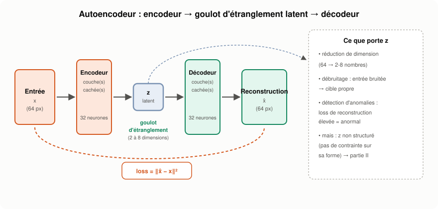

*Figure 1 — L'autoencodeur est un encodeur et un décodeur mis dos à dos, séparés par un goulot d'étranglement $z$. La seule supervision est la comparaison entre l'entrée et la reconstruction.*

L'architecture la plus simple est entièrement connectée (comme au cours 03) :

$$x \in \mathbb{R}^{64} \;\xrightarrow{\text{encodeur}}\; h \in \mathbb{R}^{32} \;\xrightarrow{\text{encodeur}}\; z \in \mathbb{R}^{d} \;\xrightarrow{\text{décodeur}}\; h' \in \mathbb{R}^{32} \;\xrightarrow{\text{décodeur}}\; \hat x \in \mathbb{R}^{64}$$

avec $d \ll 64$ (typiquement 2 à 8 dans ce cours, pour pouvoir visualiser l'espace latent). La seule contrainte architecturale forte est que **la sortie du décodeur ait la même forme que l'entrée** — le reste (nombre de couches, largeur) est un choix libre, exactement comme pour n'importe quel réseau du cours 03.

> ⚠️ **Piège** : si le goulot n'est pas assez étroit (par exemple $d = 64$, la même dimension que l'entrée), le réseau peut apprendre la fonction identité parfaite sans rien apprendre d'utile sur la structure des données. Le goulot doit être une vraie contrainte.

---

## 3. 🧩 Implémentation NumPy et entraînement sur des chiffres manuscrits

On réutilise le jeu `load_digits` de scikit-learn : 1 797 images de chiffres manuscrits en 8×8 pixels (64 valeurs), normalisées dans $[0, 1]$.

```python
import numpy as np
from sklearn.datasets import load_digits
from sklearn.model_selection import train_test_split

def relu(z):    return np.maximum(0, z)
def d_relu(z):  return (z > 0).astype(float)
def sigmoid(z): return 1 / (1 + np.exp(-z))

digits = load_digits()
X = digits.data / 16.0          # pixels dans [0, 1]
y = digits.target
X_tr, X_te, y_tr, y_te = train_test_split(X, y, test_size=0.2, random_state=42, stratify=y)
print(X_tr.shape, X_te.shape)
# (1437, 64) (360, 64)
```

Le réseau est une fonction de paramètres (dictionnaire de matrices), avec un `forward` et un `backward` écrits à la main, comme au cours 03 :

```python
def init_params(n_in=64, n_h=32, n_lat=2, seed=42):
    rng = np.random.default_rng(seed)
    def he(n1, n2): return rng.normal(0, np.sqrt(2 / n1), (n1, n2))
    return {"We1": he(n_in, n_h),  "be1": np.zeros((1, n_h)),
            "We2": he(n_h, n_lat), "be2": np.zeros((1, n_lat)),
            "Wd1": he(n_lat, n_h), "bd1": np.zeros((1, n_h)),
            "Wd2": he(n_h, n_in),  "bd2": np.zeros((1, n_in))}

def forward(X, p):
    Ze1 = X @ p["We1"] + p["be1"];  Ae1 = relu(Ze1)
    Z   = Ae1 @ p["We2"] + p["be2"]              # z = représentation latente (pas d'activation)
    Zd1 = Z @ p["Wd1"] + p["bd1"];  Ad1 = relu(Zd1)
    Zd2 = Ad1 @ p["Wd2"] + p["bd2"]
    Xhat = sigmoid(Zd2)                          # pixels reconstruits dans [0, 1]
    return {"Ze1": Ze1, "Ae1": Ae1, "Z": Z, "Zd1": Zd1, "Ad1": Ad1, "Xhat": Xhat}

def loss_fn(Xhat, X):
    return np.mean((Xhat - X) ** 2)              # MSE de reconstruction
```

Le `backward` applique la règle de la chaîne de bout en bout (sortie → décodeur → latent → encodeur → entrée) ; la mise à jour des poids se fait par descente de gradient par mini-lots, exactement comme au cours 03. Après entraînement sur 400 époques :

```
AE latent=2 -> loss finale train : 0.0524   | loss test : 0.0530
AE latent=8 -> loss finale train : 0.0235   | loss test : 0.0250
```

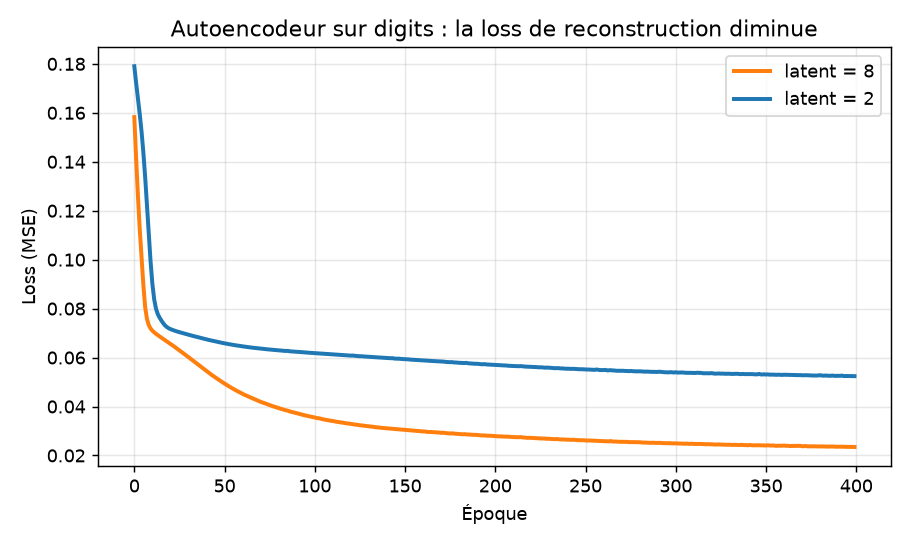

*Figure 2 — La loss de reconstruction diminue régulièrement. Avec un latent plus large (8 dimensions), le réseau dispose de plus de place pour stocker l'information : la loss finale est deux fois plus basse qu'avec un latent de 2 dimensions.*

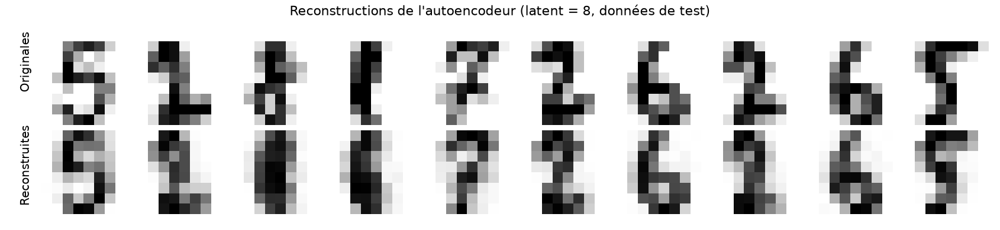

*Figure 3 — Les reconstructions sont floues mais reconnaissables : la forme générale du chiffre est préservée, les détails fins sont perdus. C'est exactement ce qu'on attend d'une compression avec perte à travers un goulot de 8 nombres pour 64 pixels.*

> 🔑 **En une phrase** : *un autoencodeur apprend une compression sur mesure pour vos données, optimisée pour minimiser l'erreur de reconstruction — contrairement à une compression générique (comme le JPEG), qui ne connaît rien de son contenu.*

---

## 4. 🧩 Trois usages pratiques

### a) Réduction de dimension

Le vecteur $z$ est, par construction, une version compressée et informative de $x$. On peut l'utiliser comme n'importe quelle réduction de dimension (à la place d'une ACP, par exemple) : entraîner un classifieur sur $z$ plutôt que sur $x$ brut, visualiser des données en 2D, accélérer une recherche de plus proches voisins.

### b) Débruitage (denoising autoencoder)

L'idée : au lieu d'entraîner le réseau à reconstruire une entrée propre à partir d'elle-même, on l'entraîne à reconstruire une entrée **propre** à partir d'une version **bruitée**. La loss compare toujours la sortie à la version propre, jamais à la version bruitée.

```python
def ajoute_bruit(X, sigma=0.4, seed=0):
    rng = np.random.default_rng(seed)
    return np.clip(X + rng.normal(0, sigma, X.shape), 0, 1)

X_tr_bruit = ajoute_bruit(X_tr, sigma=0.4, seed=1)
X_te_bruit = ajoute_bruit(X_te, sigma=0.4, seed=2)
# entraînement identique, mais la cible de la loss est X_propre, pas X_bruit
```

```
Loss si on NE débruite PAS (bruitée vs propre) : 0.0845
Loss du denoising autoencoder (débruitée vs propre) : 0.0395   (÷ 2,1)
```

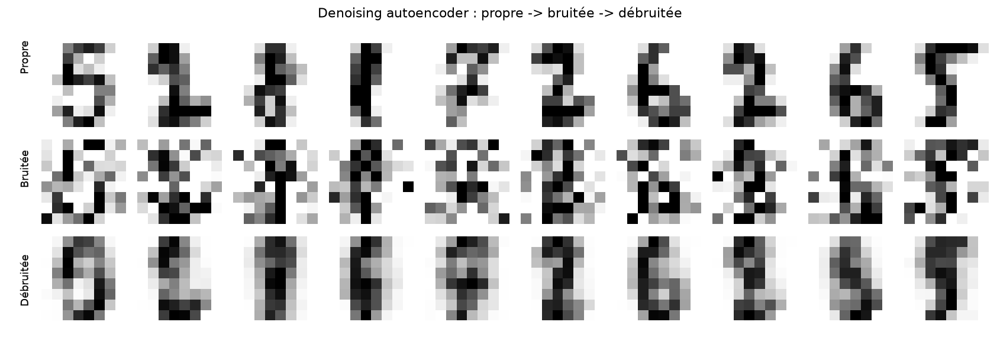

*Figure 4 — Le réseau n'a jamais vu les bruits exacts du test, mais il a appris la forme générale des chiffres : il retire une bonne partie du bruit tout en conservant la structure.*

### c) Détection d'anomalies

On entraîne un autoencodeur **uniquement sur des données considérées comme normales**. Sur une donnée normale, il reconstruit bien (faible loss). Sur une donnée qui s'écarte de ce qu'il a appris, il reconstruit mal (loss élevée) — cette loss devient un **score d'anomalie**.

Expérience : un autoencodeur entraîné seulement sur le chiffre « 0 », testé sur des « 0 » (normal) et sur les autres chiffres (anomalies) :

```
Erreur de reconstruction moyenne sur '0' (normal)    : 0.0233  (écart-type 0.0134)
Erreur de reconstruction moyenne sur les autres chiffres : 0.1177  (écart-type 0.0261)
```

L'erreur de reconstruction est en moyenne **5 fois plus élevée** sur les chiffres jamais vus à l'entraînement.

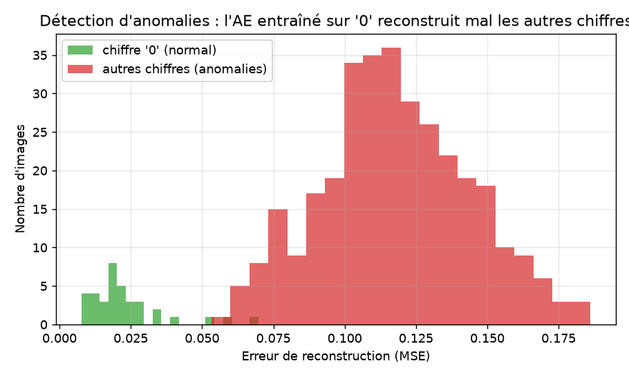

*Figure 5 — Les deux distributions se séparent nettement : un simple seuil sur l'erreur de reconstruction suffit à distinguer le normal de l'anormal. C'est le principe utilisé en maintenance prédictive (cours 05, section 8) ou en détection de fraude : on n'a besoin que d'exemples normaux pour l'entraînement.*

---

## 5. 🧩 La limite : un espace latent non structuré

Rien, dans la loss de reconstruction, n'impose de contrainte sur la **forme** de l'espace latent. Le réseau est libre de placer ses représentations $z$ n'importe où, du moment que le décodeur arrive à les reconstruire.

```python
Z_tr = forward(X_tr, p_latent2)["Z"]
print(Z_tr.min(axis=0), Z_tr.max(axis=0))
# min : [-9.27, -8.35]   max : [-0.38, -0.30]
```

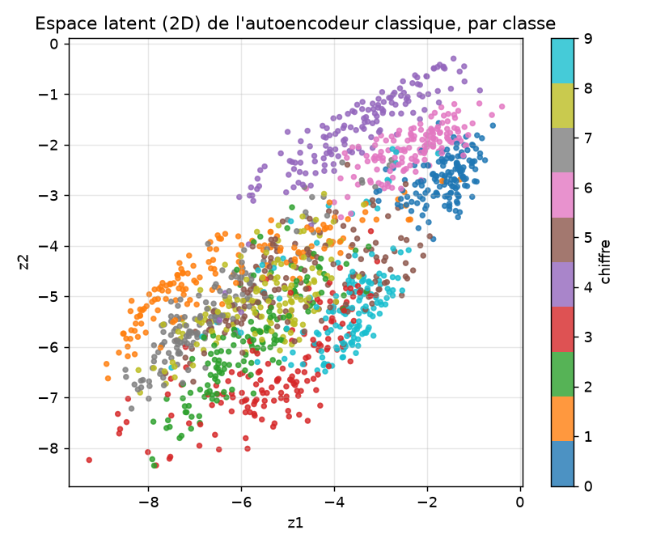

*Figure 6 — L'espace latent occupe une bande étroite et oblique, loin de l'origine, avec des classes qui se chevauchent beaucoup. Rien n'empêchait le réseau de le placer ainsi : seule la reconstruction compte.*

Conséquence pratique : si l'on prend un point **entre** deux exemples réels dans cet espace et qu'on le décode, rien ne garantit que le résultat ressemble à une donnée plausible.

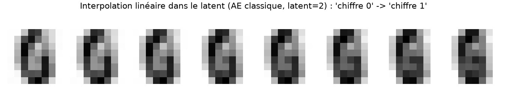

*Figure 7 — Les images intermédiaires restent des formes vagues et peu nettes, sans transition claire et reconnaissable d'un chiffre à l'autre : l'espace entre deux points connus n'a pas été entraîné à produire des images réalistes.*

> ⚠️ **Le problème** : un autoencodeur classique est excellent pour **compresser et reconstruire** des données qu'il a vues, mais mauvais pour **générer** de nouvelles données en échantillonnant dans son espace latent — cet espace n'a aucune structure probabiliste garantie.

C'est exactement le problème que le **Variational Autoencoder** (partie II) résout : en ajoutant une contrainte sur la forme de l'espace latent, il le rend utilisable pour la génération.

---

# PARTIE II — VARIATIONAL AUTOENCODER (VAE)

## 6. L'idée probabiliste : encoder une distribution, pas un point

Le VAE change une seule chose dans l'architecture : au lieu de faire produire par l'encodeur un **point** $z$, on lui fait produire les **paramètres d'une distribution** — une moyenne $\mu$ et une variance $\sigma^2$ (en pratique, on prédit $\log \sigma^2$ pour des raisons de stabilité numérique). Le $z$ utilisé par le décodeur est alors **tiré au hasard** selon cette distribution :

$$z \sim \mathcal{N}(\mu(x), \sigma^2(x))$$

> 💡 **Analogie** : l'autoencodeur classique range chaque livre résumé à une adresse précise et figée dans la bibliothèque. Le VAE range plutôt chaque livre dans un **quartier** de la bibliothèque (une zone floue autour d'une adresse centrale) : les livres qui se ressemblent finissent dans des quartiers qui se recouvrent, et explorer un quartier donne des livres cohérents entre eux.

---

## 7. 🧩 Le reparameterization trick

Problème : on veut entraîner le réseau par descente de gradient, donc calculer $\partial z / \partial \mu$ et $\partial z / \partial \sigma$. Mais un tirage aléatoire $z \sim \mathcal{N}(\mu, \sigma^2)$ n'est pas une opération différentiable — on ne peut pas remonter le gradient à travers un « tirage au sort ».

La solution (le **reparameterization trick**) consiste à sortir le hasard de l'équation : au lieu de tirer $z$ directement, on tire un bruit $\varepsilon \sim \mathcal{N}(0, 1)$ **indépendant des paramètres**, puis on calcule :

$$z = \mu + \sigma \odot \varepsilon$$

Cette écriture est strictement équivalente en loi à $z \sim \mathcal{N}(\mu, \sigma^2)$, mais maintenant $z$ est une fonction **différentiable** de $\mu$ et $\sigma$ : le hasard est isolé dans $\varepsilon$, qui ne dépend d'aucun paramètre entraînable.

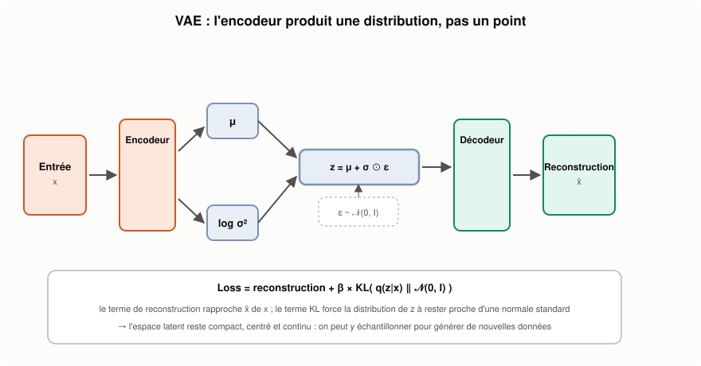

*Figure 8 — Le reparameterization trick (bloc central) permet au gradient de remonter de la loss jusqu'à l'encodeur, en traversant l'échantillonnage.*

```python
def forward(X, p, rng, sample=True):
    Ze1 = X @ p["We1"] + p["be1"]; Ae1 = relu(Ze1)
    mu = Ae1 @ p["Wmu"] + p["bmu"]
    logvar = Ae1 @ p["Wlv"] + p["blv"]
    sigma = np.exp(0.5 * logvar)
    eps = rng.normal(0, 1, mu.shape) if sample else np.zeros_like(mu)
    Z = mu + sigma * eps                       # reparameterization trick
    # ... décodeur identique à l'autoencodeur classique à partir de Z
```

---

## 8. La loss du VAE : reconstruction + divergence KL

La loss du VAE a deux termes :

$$\mathcal{L} = \underbrace{\|\hat x - x\|^2}_{\text{reconstruction}} + \beta \cdot \underbrace{D_{KL}\big(\mathcal{N}(\mu, \sigma^2) \,\|\, \mathcal{N}(0, 1)\big)}_{\text{régularisation}}$$

- Le terme de **reconstruction** est le même qu'au cours de la partie I : il pousse $\hat x$ à ressembler à $x$.
- Le terme **KL** (divergence de Kullback-Leibler) mesure à quel point la distribution produite par l'encodeur, $\mathcal{N}(\mu, \sigma^2)$, s'écarte d'une normale centrée réduite $\mathcal{N}(0, 1)$. Il a une forme fermée simple :

$$D_{KL} = -\frac{1}{2} \sum_j \left(1 + \log\sigma_j^2 - \mu_j^2 - \sigma_j^2\right)$$

Le terme KL **force** chaque exemple à être encodé autour de l'origine, avec un écart-type proche de 1 — exactement la contrainte de structure qui manquait à l'autoencodeur classique.

> 🔑 **En une phrase** : *le terme de reconstruction veut que l'espace latent soit informatif, le terme KL veut qu'il soit compact et centré ; la loss du VAE est un compromis entre les deux.*

Le coefficient $\beta$ règle ce compromis (voir section 10).

---

## 9. 🧩 Expérience : un espace latent structuré, et la génération

On entraîne un VAE sur les mêmes images `digits`, avec un espace latent 2D (pour pouvoir le visualiser), $\beta = 1$, 500 époques :

```
VAE (β=1) -> test : reconstruction = 4.159 (soit 0.065 / pixel)   KL = 0.351
```

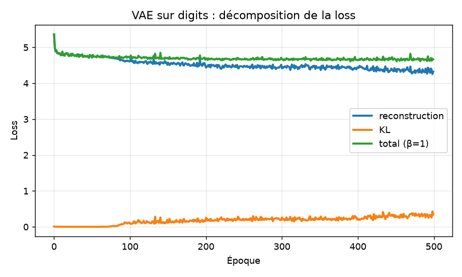

*Figure 9 — Au début, la loss KL est quasi nulle : le réseau fait tout coller à la distribution a priori sans encore utiliser l'information de $x$. À mesure que l'entraînement avance, la reconstruction s'améliore nettement (4,8 → 4,3) au prix d'une légère hausse du KL (0 → 0,35) : le réseau « dépense » un peu de régularité pour gagner en fidélité.*

```python
mu_tr = forward(X_tr, p_vae, rng, sample=False)["mu"]
print(mu_tr.min(axis=0), mu_tr.max(axis=0))
# min : [-1.02, -1.51]   max : [0.97, 1.12]
```

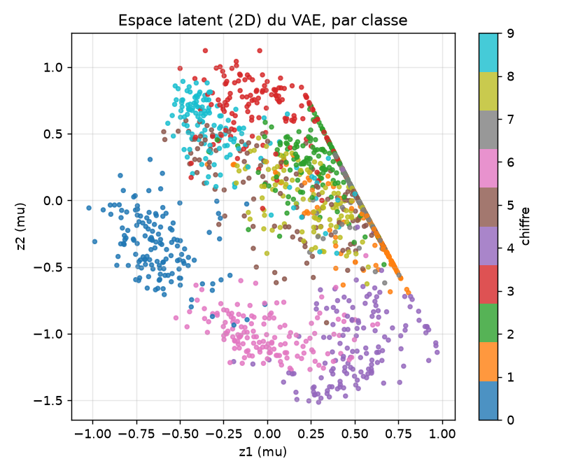

*Figure 10 — À comparer directement à la figure 6 : le nuage de points reste compact, centré sur l'origine (comme imposé par le KL), et les dix chiffres forment des régions nettement plus séparées. L'étendue du latent est d'environ 2,5 unités dans chaque direction, contre environ 9 unités pour l'autoencodeur classique.*

Parce que l'espace latent est maintenant compact et centré, on peut le **balayer systématiquement** et décoder chaque point pour générer de nouvelles images, jamais vues pendant l'entraînement :

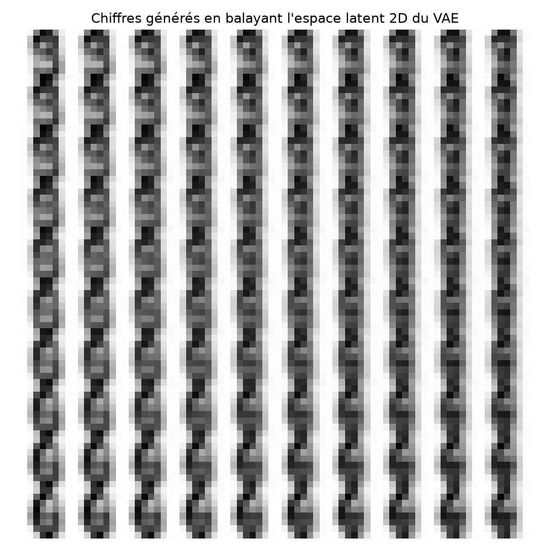

*Figure 11 — Chaque case est une image **générée**, obtenue en décodant un point de la grille. Les formes restent floues (un espace latent de 2 dimensions et un décodeur de 32 neurones sont volontairement minuscules, pour que l'exercice reste lisible et rapide à entraîner), mais on observe une transition progressive et continue d'une case à sa voisine : c'est exactement la propriété recherchée.*

```python
# interpolation entre un '0' et un '1' dans le latent du VAE
```

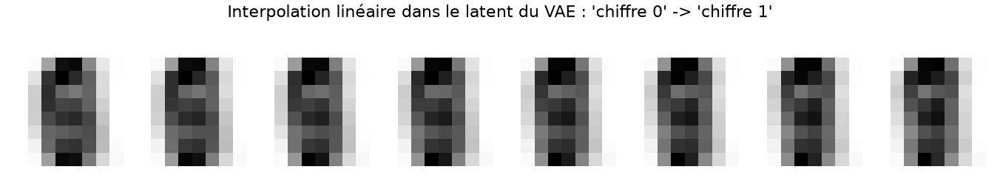

*Figure 12 — À comparer à la figure 7 : la transition est lisse, chaque image intermédiaire est une forme plausible, cohérente avec ses voisines. C'est la conséquence directe de la contrainte KL : les points proches dans le latent produisent des images proches.*

---

## 10. 🧩 β-VAE : le curseur reconstruction / régularité

Le coefficient $\beta$ devant le terme KL permet de déplacer le curseur entre fidélité de reconstruction et structure de l'espace latent. Trois entraînements, même architecture, même nombre d'époques :

| $\beta$ | Reconstruction (test, /pixel) | KL (test) | Interprétation |
|---|---|---|---|
| 0,1 | **0,040** | 4,38 | peu de contrainte : bonne reconstruction, mais latent moins compact (le KL n'est presque pas pénalisé) |
| 1,0 | 0,065 | 0,35 | compromis par défaut (c'est le VAE « standard ») |
| 5,0 | 0,074 | **≈ 0** | contrainte très forte : le KL s'effondre à presque zéro — le réseau ignore quasiment $x$ et encode (presque) tout le monde au même endroit |

> ⚠️ **Le cas $\beta = 5$ illustre le *posterior collapse*** : quand la pénalité de régularisation devient trop forte par rapport au signal de reconstruction, l'encodeur cesse d'utiliser le latent pour transmettre de l'information utile sur $x$ — la distribution produite s'effondre vers le prior $\mathcal{N}(0,1)$ quel que soit $x$, et la reconstruction devient presque aussi mauvaise que si on ignorait l'entrée.

Le $\beta$-VAE (Higgins et al., 2017) part de cette observation : en augmentant volontairement $\beta$ au-delà de 1, on peut pousser les différentes dimensions du latent à capturer chacune un facteur de variation indépendant et interprétable (par exemple, pour des visages : l'angle de la tête sur une dimension, le sourire sur une autre) — au prix d'une reconstruction plus approximative.

---

## 11. Autoencodeur classique vs VAE : la comparaison

| Critère | Autoencodeur classique | VAE |
|---|---|---|
| Sortie de l'encodeur | un point $z$ | une distribution $(\mu, \sigma)$ |
| Loss | reconstruction seule | reconstruction + $\beta \cdot$ KL |
| Reconstruction (test, /pixel, digits latent=2) | **0,053** | 0,065 (β=1) |
| Forme de l'espace latent | libre, arbitraire (ici ~9 unités d'étendue) | compact, centré (ici ~2,5 unités d'étendue) |
| Interpolation entre deux points | non réaliste (fig. 7) | lisse et plausible (fig. 12) |
| Génération par échantillonnage | **non fiable** | **oui**, par construction |
| Usage principal | compression, débruitage, anomalies | tout ce que fait l'AE, **plus** la génération |

> 🔑 **En une phrase** : *un autoencodeur classique compresse, un VAE compresse et apprend un espace dans lequel on peut se promener pour créer du nouveau — au prix d'une reconstruction légèrement moins précise.*

---

# PARTIE III — DIFFUSION MODELS

## 12. L'idée : détruire par le bruit, puis apprendre à inverser

Les modèles de diffusion abordent la génération sous un angle complètement différent de l'autoencodeur/VAE, mais répondent à la même question : *comment produire de nouvelles données qui ressemblent à celles d'un jeu d'entraînement ?*

L'idée tient en deux étapes :

1. **Processus direct (forward)** : partir d'une vraie donnée $x_0$ et lui ajouter du bruit gaussien, petit à petit, sur $T$ étapes, jusqu'à ce qu'elle devienne indiscernable d'un bruit pur $x_T$. Ce processus est **fixe** : pas de réseau de neurones, juste une formule.
2. **Processus inverse (reverse)** : entraîner un réseau à faire le chemin en sens inverse — partir d'un bruit pur et retirer le bruit étape par étape jusqu'à obtenir une donnée plausible.

> 💡 **Analogie** : une photo qu'on froisse en boule de papier, étape par étape, jusqu'à ce qu'on ne reconnaisse plus rien. Un modèle de diffusion, c'est apprendre à défroisser une boule de papier au hasard pour en ressortir une photo nette et cohérente — pas forcément la photo de départ, mais une photo plausible.

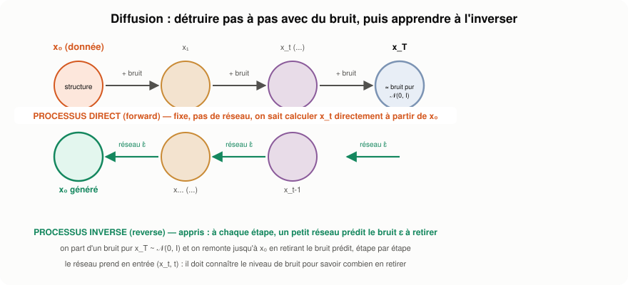

*Figure 13 — Le processus direct (flèches orange) est fixe et ne nécessite aucun apprentissage : on sait calculer directement $x_t$ à partir de $x_0$. Le processus inverse (flèches vertes) est appris : à chaque étape, un réseau prédit le bruit à retirer.*

---

## 13. Le planning de bruit et le processus direct

On définit un **planning de bruit** (noise schedule) $\beta_1, \dots, \beta_T$, une suite croissante de petites valeurs, et on pose $\alpha_t = 1 - \beta_t$, $\bar\alpha_t = \prod_{s=1}^{t} \alpha_s$. Le processus direct s'écrit alors, en une seule formule fermée (sans boucle) :

$$x_t = \sqrt{\bar\alpha_t}\, x_0 + \sqrt{1 - \bar\alpha_t}\, \varepsilon, \qquad \varepsilon \sim \mathcal{N}(0, I)$$

Autrement dit, $x_t$ est un mélange de la donnée originale et de bruit, dont les proportions sont fixées à l'avance par $\bar\alpha_t$ : proche de $t=0$, $\bar\alpha_t \approx 1$ et $x_t \approx x_0$ ; proche de $t=T$, $\bar\alpha_t \approx 0$ et $x_t$ est presque du bruit pur.

```python
T = 40
beta = np.linspace(1e-4, 0.2, T)
alpha = 1 - beta
alpha_bar = np.cumprod(alpha)

def q_sample(x0, t_idx, rng):
    ab = alpha_bar[t_idx].reshape(-1, 1)
    eps = rng.normal(0, 1, x0.shape)
    xt = np.sqrt(ab) * x0 + np.sqrt(1 - ab) * eps
    return xt, eps
```

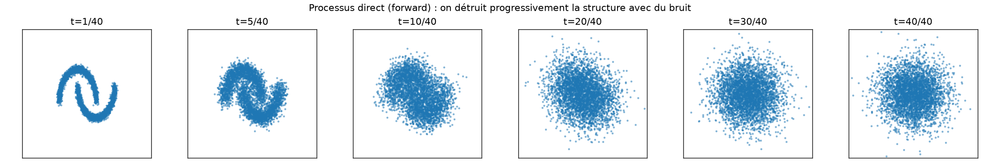

*Figure 14 — On part d'une structure claire (deux croissants) et, en 40 étapes, elle se dissout complètement dans un nuage gaussien. Chaque étape est calculée directement avec la formule ci-dessus, sans itérer pas à pas.*

---

## 14. Le processus inverse : apprendre à débruiter

Le réseau de diffusion n'apprend **pas** à générer directement une image à partir de rien : il apprend une tâche beaucoup plus simple et locale — **prédire le bruit $\varepsilon$** qui a été ajouté à $x_0$ pour obtenir $x_t$, sachant $x_t$ et l'étape $t$.

$$\mathcal{L} = \mathbb{E}\left[\|\varepsilon - \varepsilon_\theta(x_t, t)\|^2\right]$$

C'est une simple régression (MSE), comme toutes celles vues depuis le cours 03 — la seule différence est que l'entrée du réseau contient aussi l'information de temps $t$, pour qu'il sache quel niveau de bruit il doit s'attendre à retirer.

Une fois ce réseau $\varepsilon_\theta$ entraîné, on génère une nouvelle donnée en partant d'un bruit pur $x_T \sim \mathcal{N}(0, I)$ et en répétant, de $t = T$ à $t = 1$ :

$$x_{t-1} = \frac{1}{\sqrt{\alpha_t}}\left(x_t - \frac{\beta_t}{\sqrt{1-\bar\alpha_t}}\,\varepsilon_\theta(x_t, t)\right) + \sigma_t z, \qquad z \sim \mathcal{N}(0, I) \text{ (sauf à la dernière étape)}$$

Chaque étape retire **un peu** du bruit prédit, puis en rajoute un tout petit peu (le terme $\sigma_t z$) pour la stabilité du processus — c'est ce faible bruit résiduel qui permet de générer des échantillons différents à chaque tirage, plutôt que toujours le même.

---

## 15. 🧩 Implémentation NumPy et expérience sur un jeu de données 2D

Pour que l'entraînement reste rapide et le résultat facile à visualiser, on travaille sur un jeu de données jouet en 2D : `make_moons` de scikit-learn (deux croissants entrelacés), normalisé en moyenne 0 et écart-type 1.

Le réseau $\varepsilon_\theta$ est un petit MLP qui prend en entrée $(x_1, x_2, t/T)$ et prédit un bruit 2D :

```python
def init_params(n_in=3, n_h=128, n_out=2, seed=0):
    rng = np.random.default_rng(seed)
    def he(n1, n2): return rng.normal(0, np.sqrt(2 / n1), (n1, n2))
    return {"W1": he(n_in, n_h), "b1": np.zeros((1, n_h)),
            "W2": he(n_h, n_h),  "b2": np.zeros((1, n_h)),
            "W3": he(n_h, n_out), "b3": np.zeros((1, n_out))}

def forward(Xin, p):
    A1 = relu(Xin @ p["W1"] + p["b1"])
    A2 = relu(A1 @ p["W2"] + p["b2"])
    return A2 @ p["W3"] + p["b3"]               # pas d'activation : on prédit un bruit gaussien

# boucle d'entraînement : à chaque itération, un batch de x0 réels,
# un t aléatoire par exemple, on calcule x_t et eps_true avec q_sample,
# puis une descente de gradient (Adam) sur la MSE entre eps prédit et eps_true
```

Entraîné sur 4 000 itérations (optimiseur Adam, $T=40$ étapes de bruit) :

```
Loss de débruitage (MSE sur le bruit prédit), derniers points d'entraînement : ≈ 0,35–0,40
(rappel : un réseau qui prédirait toujours zéro aurait une loss de 1,0 — la variance du bruit)
```

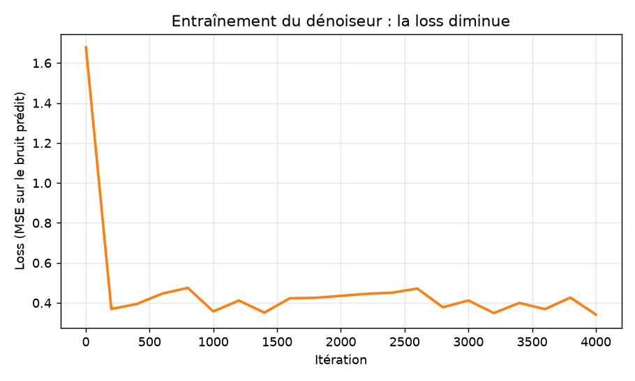

*Figure 15 — La loss diminue nettement par rapport à la prédiction triviale (toujours zéro, loss = 1), signe que le réseau a bien appris à anticiper une partie du bruit ajouté à chaque étape.*

On génère ensuite 1 000 nouveaux points en partant de bruit pur et en appliquant le processus inverse :

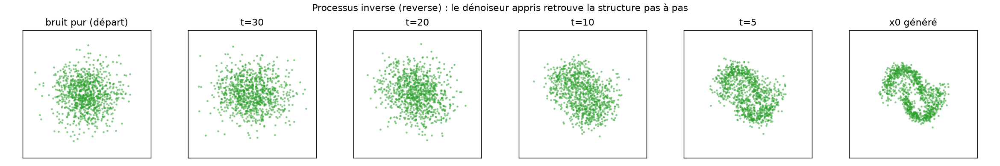

*Figure 16 — Étape après étape, le nuage de points informe passe d'un blob gaussien à une forme clairement structurée. C'est la même dynamique que la figure 14, mais parcourue en sens inverse — et cette fois, c'est le réseau appris qui pilote chaque étape, pas une formule fixe.*

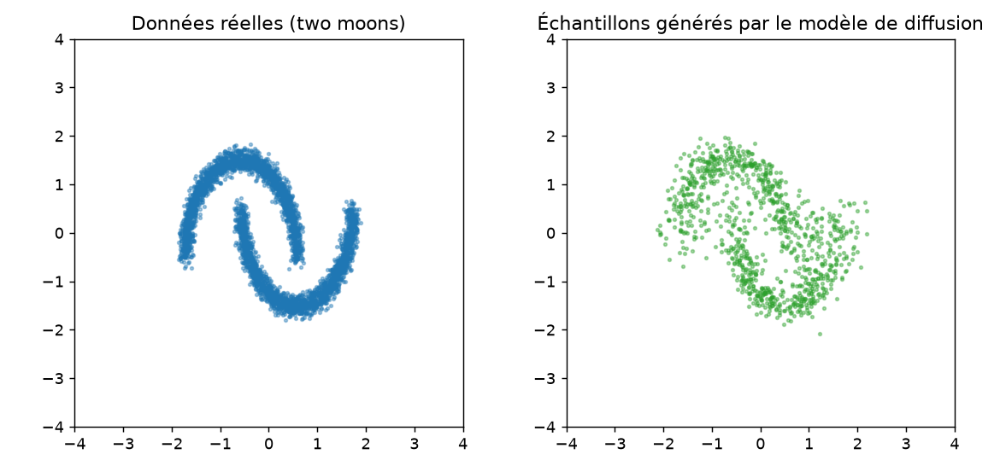

*Figure 17 — Les échantillons générés (à droite) reproduisent fidèlement la forme en deux croissants entrelacés des données réelles (à gauche), sans qu'aucun des points générés ne soit une copie d'un point d'entraînement.*

> 🔑 **En une phrase** : *un modèle de diffusion n'apprend jamais à générer directement — il apprend seulement à retirer un petit peu de bruit à la fois, et c'est la répétition de ce petit geste, des dizaines de fois, qui fait émerger une donnée complète et plausible.*

---

## 16. 🧩 Panorama des modèles génératifs

| Famille | Principe | Stabilité d'entraînement | Qualité de génération | Coût (entraînement / génération) |
|---|---|---|---|---|
| **Autoencoder** | compresser puis reconstruire | très stable (une seule loss simple) | pas conçu pour générer | faible / instantané |
| **VAE** | compresser vers une distribution régularisée | stable | correcte mais souvent floue (compromis recon/KL) | faible / instantané |
| **GAN** *(pour le panorama — non traité en détail ici)* | un générateur et un discriminateur s'affrontent | **difficile** (mode collapse, déséquilibres) | très nette, parfois photoréaliste | moyen / instantané |
| **Diffusion** | détruire par le bruit, apprendre à inverser pas à pas | stable (une simple MSE à chaque étape) | très bonne, actuellement état de l'art en image | élevé / lent (des dizaines à des centaines d'étapes) |

Le GAN (*Generative Adversarial Network*, Goodfellow et al., 2014) oppose deux réseaux : un **générateur** qui essaie de produire des données crédibles, et un **discriminateur** qui essaie de distinguer le vrai du généré ; les deux s'améliorent en se faisant concurrence. Il ne sera pas développé davantage dans ce cours, mais il complète ce panorama : c'est l'approche qui a dominé la génération d'images entre 2014 et 2020, avant que la diffusion ne s'impose.

---

## 17. 🧩 La diffusion en pratique aujourd'hui

Les modèles de diffusion utilisés en production (Stable Diffusion, DALL-E, Midjourney) suivent le même principe que celui codé dans ce cours, avec deux différences majeures :

1. **La diffusion a lieu dans un espace latent, pas sur les pixels.** Un autoencodeur (très proche de celui de la partie I !) compresse d'abord l'image dans un espace latent plus petit ; c'est dans cet espace, beaucoup moins coûteux, que se déroule le processus de bruitage/débruitage. L'image finale est obtenue en décodant le résultat. C'est le principe de la *Latent Diffusion* (Rombach et al., 2022), à l'origine de Stable Diffusion.
2. **Le débruitage est conditionné par du texte.** Le réseau $\varepsilon_\theta(x_t, t)$ reçoit en plus l'encodage d'un prompt texte (produit par un modèle proche de BERT, cours 06) : il n'apprend plus seulement « quel bruit retirer », mais « quel bruit retirer **pour aller vers une image qui correspond à ce texte** ».

> 🧭 Le cours de ce module forme ainsi une boucle complète : le cours 06 a donné le vocabulaire encodeur/décodeur et les bases du texte ; ce cours en a fait un usage génératif (VAE, diffusion) ; et la diffusion texte-image combine les deux — un encodeur de texte guide un processus de diffusion dans un espace latent.

---

# PARTIE IV — SYNTHÈSE

## 18. Conclusion

### 🎓 Ce qu'il faut absolument retenir

1. **Un autoencodeur** est un encodeur et un décodeur entraînés ensemble à reconstruire leur entrée à travers un goulot d'étranglement latent — une tâche non supervisée, utile pour la réduction de dimension, le débruitage et la détection d'anomalies.
2. **Sa limite** : rien ne contraint la forme de son espace latent ; échantillonner un point au hasard (ou interpoler entre deux points connus) ne produit généralement pas une donnée plausible.
3. **Le VAE** résout ce problème en faisant produire par l'encodeur une distribution $(\mu, \sigma)$ plutôt qu'un point, régularisée vers $\mathcal{N}(0, 1)$ par un terme de divergence KL dans la loss.
4. **Le reparameterization trick** ($z = \mu + \sigma \odot \varepsilon$) rend cet échantillonnage différentiable, donc entraînable par descente de gradient.
5. **Le coefficient $\beta$** règle le compromis entre fidélité de reconstruction et compacité/régularité du latent ; un $\beta$ trop grand mène au *posterior collapse* (le latent cesse de transmettre de l'information sur $x$).
6. **Expérimentalement** (digits, latent 2D) : l'espace latent du VAE occupe environ 2,5 unités d'étendue contre 9 pour l'autoencodeur classique, et ses interpolations/générations sont nettement plus plausibles — au prix d'une reconstruction légèrement moins précise (0,065 vs 0,053 par pixel).
7. **Les modèles de diffusion** génèrent en apprenant l'inverse d'un processus de bruitage progressif fixe : un petit réseau prédit, à chaque étape, le bruit à retirer.
8. **Expérimentalement** (two moons) : un simple MLP entraîné à prédire du bruit, appliqué 40 fois en partant de bruit pur, retrouve fidèlement la structure des données d'origine.
9. **Panorama** : Autoencoder/VAE sont rapides à entraîner et à générer mais plus flous ; les GAN génèrent net mais s'entraînent difficilement ; la diffusion est stable à entraîner et produit l'état de l'art actuel, au prix d'une génération lente (de nombreuses étapes).
10. **En production**, la diffusion se fait dans un espace latent (pas sur les pixels bruts) et se conditionne par du texte — combinant exactement les deux cours de ce module.

### 🧭 Le mémo en une image

```
┌──────────────────────────────────────────────────────────────────────────┐
│  AUTOENCODER   : encodeur → goulot → décodeur, loss = reconstruction      │
│                  ✔ compression, débruitage, anomalies   ✘ génération      │
│                                                                            │
│  VAE           : encodeur → (μ, σ) → z = μ + σ·ε → décodeur               │
│                  loss = reconstruction + β · KL(latent, 𝒩(0,1))           │
│                  ✔ génération par échantillonnage dans un latent compact  │
│                                                                            │
│  DIFFUSION     : forward = bruiter pas à pas (fixe)                       │
│                  reverse  = réseau appris à prédire le bruit à retirer    │
│                  ✔ qualité état de l'art     ✘ génération lente (étapes)  │
└──────────────────────────────────────────────────────────────────────────┘
```

> 🔑 **En une phrase** : *compresser avec perte (autoencodeur), compresser vers un espace qu'on peut explorer (VAE), ou apprendre à défaire le chaos pas à pas (diffusion) — trois façons différentes d'apprendre à fabriquer de nouvelles données qui ressemblent à celles qu'on a vues.*

---

## 19. ✅ Point de contrôle — Autoencoders, VAE et Diffusion

### 🧠 Questions de compréhension

<details>
<summary><b>1. Quelle est la différence entre la tâche d'un autoencodeur et celle de l'encodeur-décodeur vu au cours 06 ?</b></summary>

Au cours 06, le décodeur produit une sortie *différente* de l'entrée (une traduction). Dans un autoencodeur, le décodeur doit reproduire *la même* donnée que l'entrée : c'est une tâche de reconstruction non supervisée, sans étiquette.
</details>

<details>
<summary><b>2. Pourquoi le goulot d'étranglement est-il indispensable ? Que se passerait-il sans lui ?</b></summary>

Sans goulot (si $z$ a la même dimension que $x$, ou plus), le réseau peut apprendre la fonction identité parfaite sans extraire d'information utile. Le goulot force le réseau à compresser, donc à apprendre ce qui est essentiel dans les données.
</details>

<details>
<summary><b>3. Citez les trois usages pratiques d'un autoencodeur vus dans ce cours, avec un exemple chacun.</b></summary>

Réduction de dimension (visualiser ou accélérer un traitement sur $z$ plutôt que sur $x$) ; débruitage (entraîner à reconstruire une version propre à partir d'une version bruitée, loss ÷ 2 dans l'expérience) ; détection d'anomalies (loss de reconstruction élevée = donnée hors distribution, facteur ×5 observé entre '0' et les autres chiffres).
</details>

<details>
<summary><b>4. Pourquoi l'interpolation dans le latent d'un autoencodeur classique donne-t-elle des images peu réalistes ?</b></summary>

Rien dans la loss de reconstruction ne contraint la forme de l'espace entre deux points connus. Le réseau n'a jamais été entraîné à produire des sorties plausibles pour les points qui ne correspondent à aucune donnée réelle.
</details>

<details>
<summary><b>5. Qu'est-ce qui change, architecturalement, entre un autoencodeur classique et un VAE ?</b></summary>

L'encodeur ne produit plus un point $z$ unique, mais les paramètres $(\mu, \log\sigma^2)$ d'une distribution gaussienne ; $z$ est ensuite tiré selon cette distribution plutôt que calculé directement.
</details>

<details>
<summary><b>6. À quoi sert le reparameterization trick, et comment fonctionne-t-il ?</b></summary>

Un tirage aléatoire $z \sim \mathcal{N}(\mu,\sigma^2)$ n'est pas différentiable, donc le gradient ne peut pas remonter jusqu'à l'encodeur. En écrivant $z = \mu + \sigma \odot \varepsilon$ avec $\varepsilon \sim \mathcal{N}(0,1)$ tiré indépendamment des paramètres, $z$ redevient une fonction différentiable de $\mu$ et $\sigma$.
</details>

<details>
<summary><b>7. Quels sont les deux termes de la loss du VAE, et quel rôle joue chacun ?</b></summary>

Le terme de reconstruction pousse $\hat x$ à ressembler à $x$ (comme pour un AE classique). Le terme KL force la distribution produite par l'encodeur à rester proche de $\mathcal{N}(0,1)$, ce qui rend l'espace latent compact et exploitable pour la génération.
</details>

<details>
<summary><b>8. Dans l'expérience à β=5, le KL s'effondre à (presque) zéro et la reconstruction est la pire des trois réglages. Expliquez ce phénomène.</b></summary>

C'est le *posterior collapse* : la pénalité KL est si forte que le réseau a intérêt à ignorer $x$ et à toujours produire une distribution proche de $\mathcal{N}(0,1)$, quel que soit $x$. Le latent cesse de transmettre de l'information utile, donc le décodeur ne peut plus bien reconstruire.
</details>

<details>
<summary><b>9. Pourquoi peut-on générer de nouvelles images avec un VAE, mais pas de façon fiable avec un autoencodeur classique ?</b></summary>

Le terme KL garantit que l'espace latent du VAE est compact, centré et continu : n'importe quel point raisonnable de cet espace décode vers une image plausible. L'autoencodeur classique n'a aucune garantie de ce type : son espace latent peut être arbitrairement étendu, excentré et discontinu.
</details>

<details>
<summary><b>10. Que prédit exactement le réseau d'un modèle de diffusion ? Ce n'est pas l'image elle-même — quoi alors ?</b></summary>

Il prédit le bruit $\varepsilon$ qui a été ajouté à la donnée d'origine $x_0$ pour obtenir $x_t$, à une étape $t$ donnée. C'est une simple régression MSE, répétée à de nombreuses étapes différentes.
</details>

<details>
<summary><b>11. Pourquoi le réseau de diffusion a-t-il besoin de connaître $t$ en plus de $x_t$ ?</b></summary>

La quantité de bruit présente dans $x_t$ dépend de l'étape $t$ (via $\bar\alpha_t$). Sans connaître $t$, le réseau ne saurait pas s'il doit retirer beaucoup de bruit (début du processus inverse, $t$ proche de $T$) ou très peu (fin du processus, $t$ proche de 0).
</details>

<details>
<summary><b>12. Pourquoi le processus direct ne nécessite-t-il aucun entraînement, contrairement au processus inverse ?</b></summary>

Le processus direct suit une formule fermée fixe ($x_t = \sqrt{\bar\alpha_t}\,x_0 + \sqrt{1-\bar\alpha_t}\,\varepsilon$) : on sait calculer $x_t$ directement, sans réseau. Le processus inverse, lui, n'a pas de formule connue à l'avance — c'est pourquoi un réseau doit l'apprendre à partir de données.
</details>

<details>
<summary><b>13. Dans le panorama de la section 16, pourquoi dit-on que la diffusion est plus stable à entraîner qu'un GAN ?</b></summary>

La diffusion optimise une simple MSE de prédiction de bruit, une loss lisse et bien comportée. Le GAN optimise un jeu à somme nulle entre deux réseaux qui s'affrontent, ce qui peut déséquilibrer l'entraînement (un réseau domine l'autre, *mode collapse*, oscillations).
</details>

<details>
<summary><b>14. Qu'apporte la diffusion « latente » (type Stable Diffusion) par rapport à une diffusion directement sur les pixels ?</b></summary>

Elle fait d'abord passer l'image par un autoencodeur pour la compresser dans un espace latent plus petit, et effectue le processus de bruitage/débruitage dans cet espace plus compact — ce qui réduit fortement le coût de calcul par rapport à une diffusion sur l'image pixel par pixel.
</details>

### 🛠️ Exercices pratiques

1. **Goulot et qualité** : reprenez l'autoencodeur de la section 3 et entraînez-le avec `n_lat` valant successivement 1, 4, 16 et 32. Tracez la loss de test finale en fonction de `n_lat`. À partir de quelle taille les gains deviennent-ils marginaux ?
2. **β-VAE à votre main** : entraînez un VAE avec `beta=0.5` et `beta=2.0` en plus des trois valeurs du cours. Placez les cinq points (reconstruction, KL) sur un même graphique. Commentez la forme de la courbe obtenue.
3. **Détection d'anomalies sur un autre chiffre** : reprenez l'expérience de la section 4c, mais entraînez l'autoencodeur uniquement sur le chiffre « 8 » au lieu du « 0 ». Le facteur de séparation entre normal et anormal est-il aussi net ? Pourquoi pourrait-il être différent ?
4. **Changer le planning de bruit** : dans le modèle de diffusion de la section 15, remplacez `np.linspace(1e-4, 0.2, T)` par `np.linspace(1e-4, 0.5, T)` (bruit final plus fort) et par `T=20` (deux fois moins d'étapes). Dans les deux cas, regardez la figure de comparaison finale (comme la figure 17) : la qualité de génération se dégrade-t-elle ? Reliez votre observation au compromis vu en section 14 entre nombre d'étapes et qualité.

---

*📘 Module Data Science — Advanced Architectures | Bootcamp Data Science*
